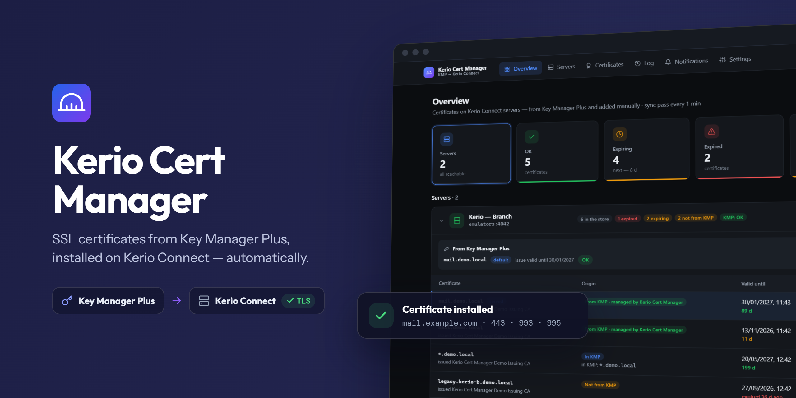
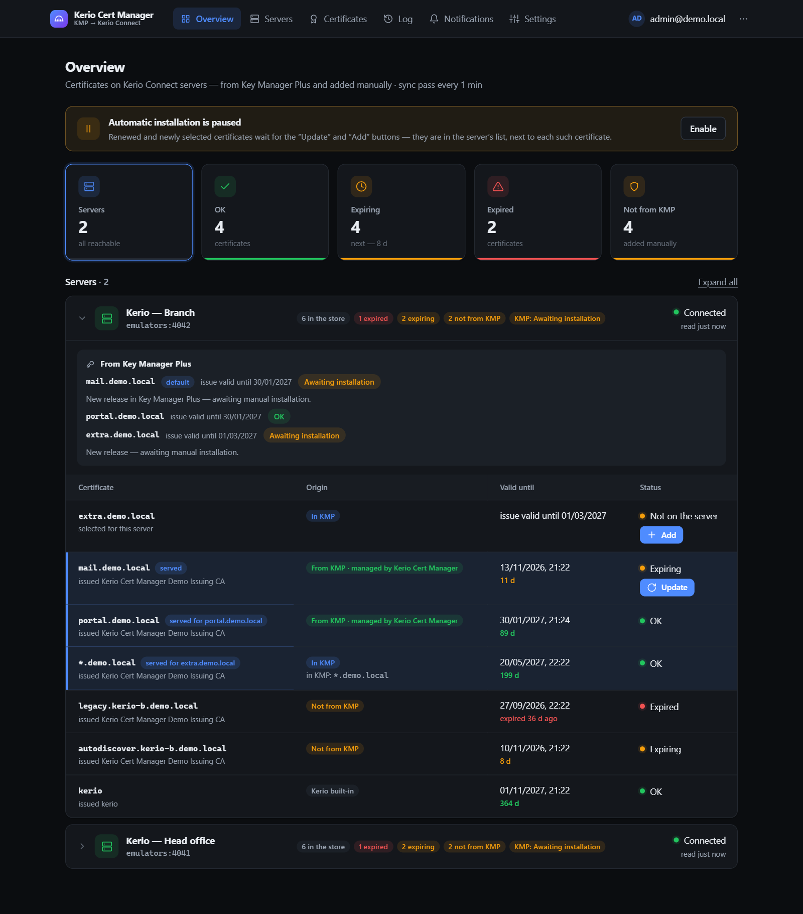
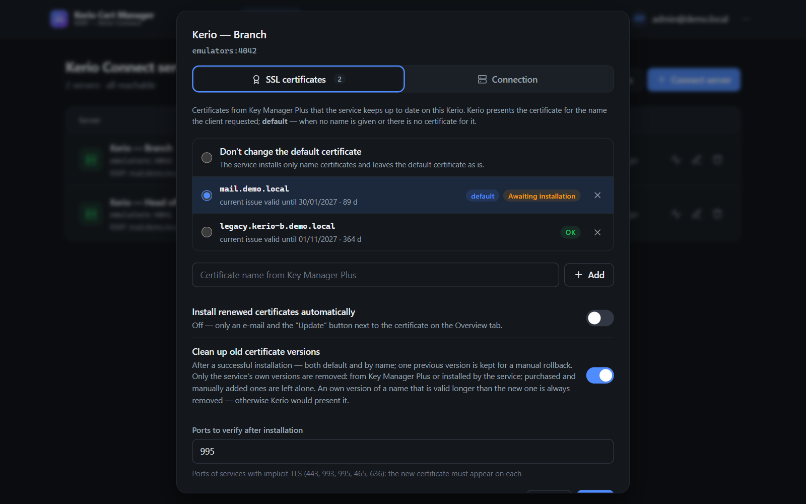
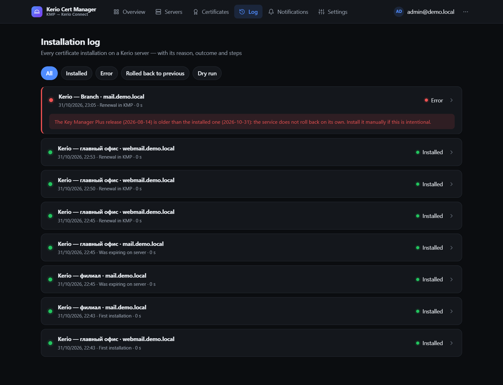
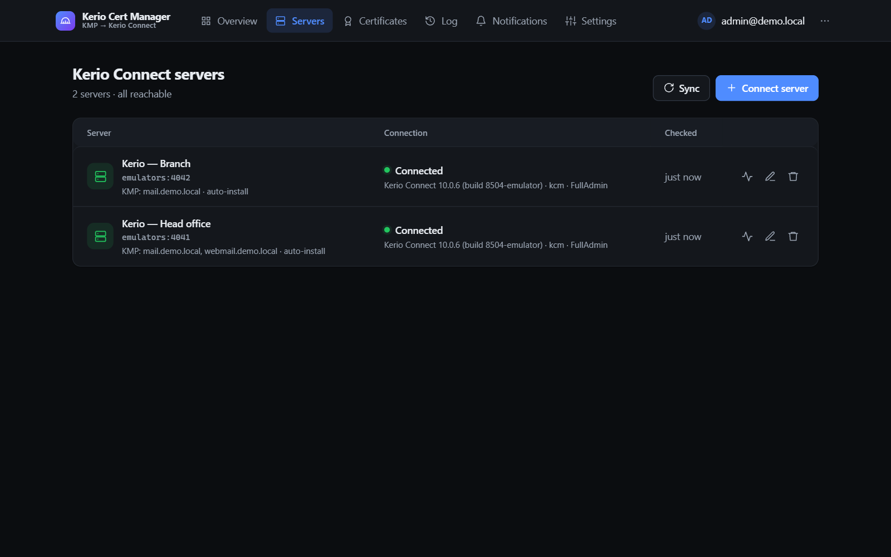
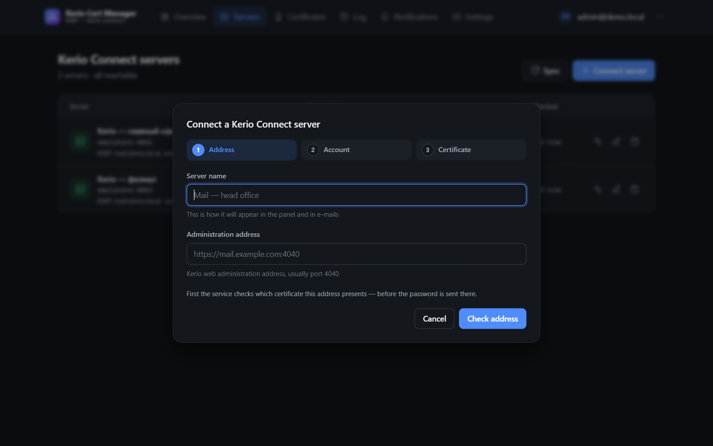
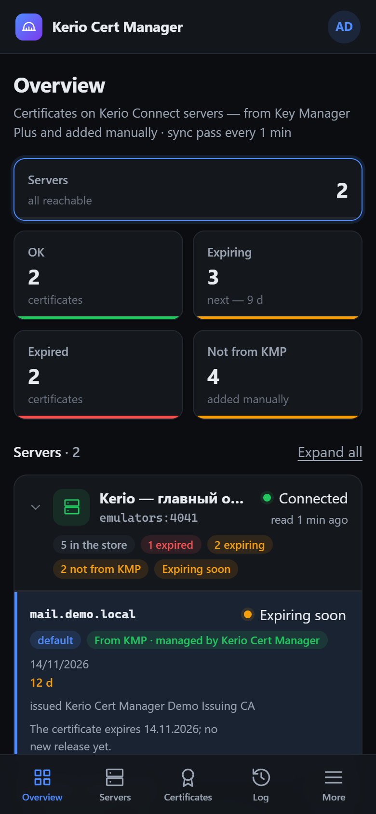
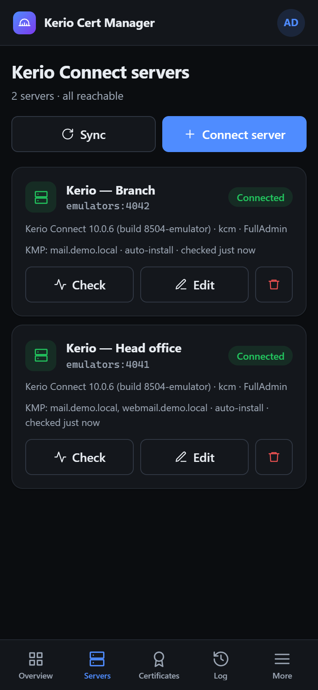
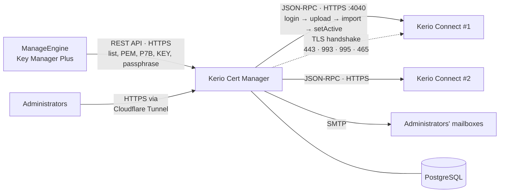
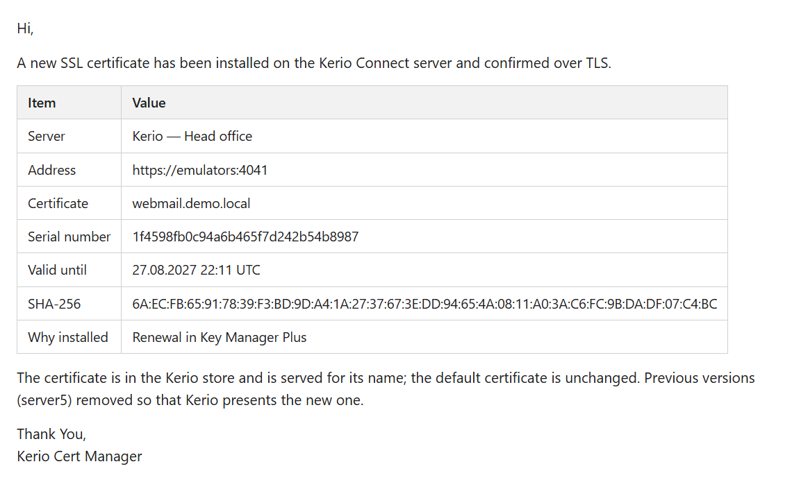

<p align="center">
  
</p>

<p align="center">
  <b>SSL certificates from ManageEngine Key Manager Plus, installed on Kerio Connect — automatically.</b><br>
  A certificate is renewed in Key Manager Plus, and minutes later it is installed on every Kerio Connect server,
  verified over TLS on every port, and the administrators get a report by e-mail.
</p>

<p align="center">
  <a href="https://github.com/danrey-bilo/Kerio-Cert-Manager/releases/latest"></a>
  <a href="https://hub.docker.com/r/danreero/kerio_cert_manager"></a>
  <a href="LICENSE"></a>
  
  
  
  
  
  
</p>

<p align="center">
  <b>English</b> · <a href="README.ru.md">Русский</a>
</p>

<p align="center">
  
</p>

## Why

Certificates live and get renewed in ManageEngine Key Manager Plus (KMP), but on Kerio Connect they are still
installed by hand: download the key and the certificate, open the Kerio administration, import, make it the
default, check every port. Certificate lifetimes keep getting shorter, and doing this by hand stops scaling.

Kerio Cert Manager does it for you:

- it **notices a renewal in KMP** — a new serial number for the same Common Name;
- it **installs it on every linked Kerio Connect** through the administration API, with a dedicated service account;
- it **verifies the result with a TLS handshake** on the administration port and the service ports (IMAPS,
  POP3S, SMTPS…), with and without SNI;
- it **rolls back on its own** when the new certificate does not come up;
- it **e-mails the administrators**: what was installed, what failed and why, which certificate expires soon.

## Features

| Feature | What you get |
|---|---|
| **Many Kerio servers** | Each with its own address, account, TLS trust, certificates from KMP, ports to verify and recipients |
| **Default and name certificates** | One certificate per server is the *default* (served without SNI); any others are *name certificates* that Kerio serves by SNI. Names are validated against KMP before saving |
| **Auto-install** | On a renewal in KMP, and when the certificate on the server expires soon while KMP has a longer one. A global switch and a per-server switch |
| **Update** / **Add** | In the server's list on the Overview tab, under the certificate's status, with a fresh second-factor code — only for certificates selected for this server: **Update** when Key Manager Plus has a newer release, **Add** when the certificate is not in Kerio yet; step by step in the Log |
| **Install queue** | Certificates are installed one at a time across the whole service: one per server per pass, the next pass right after Kerio restarts HTTPS. Clicked certificates go first, then expired, missing and soonest-expiring ones. Any number of certificates per server |
| **Verification and rollback** | After activation the new certificate must appear on every verified port; if it does not, the previous one is restored and verified the same way |
| **Dry run** | Everything is checked — key, chain, Kerio sign-in, store — but Kerio is not changed. For the first days |
| **Protection** | An older release is never installed automatically; a manual change on the server is not overwritten — only reported; certificates bought or placed by hand are never removed |
| **Installation log** | Every installation: reason, outcome, timed steps, fingerprints, ids in the Kerio store |
| **E-mails** | Installed, failed, expiring soon, expired, unreachable, password rejected, certificate changed by hand — without repeats more often than configured |
| **Web panel** | **Overview** — every Kerio store: what is served, what comes from KMP, what was placed by hand, what expires. **Servers** — connection, sync, the connect wizard, editing, deletion with a 2FA code. **Notifications** — events, thresholds, recipients, a test e-mail, history. Also: KMP certificates (view only), installation log, audit log with CSV export, settings, users. Works on phones |
| **Three languages** | English, Ukrainian and Russian — every user picks their own in the **Profile**. The panel and the server texts (errors, installation steps, statuses) follow it; notification e-mails have their own language setting |
| **Security** | Password plus authenticator app (TOTP), a fresh code before every sensitive action, AES-256-GCM encryption of every secret, strict TLS to KMP, a pinned fingerprint or a CA for Kerio, hash-chained audit log |
| **Deployment** | One public Docker image on Docker Hub ([`danreero/kerio_cert_manager`](https://hub.docker.com/r/danreero/kerio_cert_manager)), PostgreSQL and Cloudflare Tunnel — no inbound ports on your server. Portainer-friendly |

## Screenshots

<table>
  <tr>
    <td width="50%"></td>
    <td width="50%"></td>
  </tr>
  <tr>
    <td align="center"><sub>A server: the default certificate and a name certificate from KMP</sub></td>
    <td align="center"><sub>The installation log: every step, timed</sub></td>
  </tr>
  <tr>
    <td></td>
    <td></td>
  </tr>
  <tr>
    <td align="center"><sub>Servers: connection status and actions</sub></td>
    <td align="center"><sub>The connect wizard: address, account, certificate</sub></td>
  </tr>
  <tr>
    <td colspan="2" align="center">&nbsp;&nbsp;&nbsp;</td>
  </tr>
  <tr>
    <td colspan="2" align="center"><sub>The panel on a phone</sub></td>
  </tr>
</table>

## How it works



One sync pass runs every `keymanager.poll_minutes` (15 minutes by default) or on **Sync**:

1. **KMP poll** — the list of certificates: Common Name, serial number, expiry. A renewal is a new serial for the
   same Common Name.
2. **Every server is checked** — what it serves over TLS (the source of truth), whether the account can sign in to
   the API, its role, the Kerio version, the whole certificate store.
3. **Decision** — a new release of a linked name in KMP while the server serves the old one means an installation.
4. **Installation**, every step logged: export from KMP → key pair check (the key matches, name, validity, chain) →
   Kerio sign-in → what is served now → upload of the key and the certificate with its chain → import →
   activation (default certificate) → **TLS check on every port** → rollback on failure → cleanup of old versions.
5. **E-mails** to the administrators and an audit log entry.

Kerio Connect 10.0.6 quirks found on a live server and handled in code are described in
[docs/KERIO-API.md](docs/KERIO-API.md).

## What administrators get



A report for every installation, plus warnings: expiring soon (21, 7, 3, 1 days by default), expired, not updated
automatically, installation failed or rolled back, server unreachable, Kerio rejected the password or the trust
check, the certificate was changed by hand, the linked certificate disappeared from KMP. A warning that is still
true is repeated no more often than the configured interval.

## Requirements

| What | Why |
|---|---|
| A Linux server with Docker Engine and Compose v2, or Portainer | The service, its database and the tunnel run in containers |
| Kerio Connect 9.0.2 or newer (tested on 10.0.6) | Certificates by name (SNI) appeared in 9.0.2 |
| A dedicated Kerio account with **full administration** rights and **without** a second factor | The service signs in to the administration API with it |
| Key Manager Plus 7.1.1+ with its REST API key | Where the certificates come from |
| A mailbox with SMTP access | Reports and warnings are sent from it |
| A domain in Cloudflare (or your own reverse proxy with TLS) | Publishing the panel without inbound ports |

The server needs outbound access to Key Manager Plus (usually `:6565`), to every Kerio Connect (`:4040` and the
service ports you want verified), to your SMTP server and to Cloudflare. No inbound ports are needed.

## Installation with Portainer

The **`kerio-cert-manager-vX.Y.Z.zip`** archive from [Releases](../../releases) has everything for the stack:
`docker-compose.yml`, `.env.example` with hints and a step-by-step README. The stack pulls the public image
[`danreero/kerio_cert_manager`](https://hub.docker.com/r/danreero/kerio_cert_manager) from Docker Hub by itself;
the image archive inside the release is only for servers without internet access (**Images → Import**).

1. Fill in `.env.example`: `KCM_MASTER_KEK` (`openssl rand -base64 32`), `POSTGRES_PASSWORD` and
   `KCM_APP_PASSWORD` (`openssl rand -hex 24`, different ones), `CLOUDFLARE_TUNNEL_TOKEN`,
   `KCM_INIT_ADMIN_EMAIL` and `KCM_INIT_ADMIN_PASSWORD`.
2. **Stacks → Add stack** → name `kerio-cert-manager` → **Upload** → `docker-compose.yml` →
   **Load variables from .env file** → **Deploy the stack**.
3. In Cloudflare, for the tunnel: **Public Hostname** → `HTTP` → `api:8001`. Turn on Cloudflare Access (below).
4. Within an hour, sign in as the administrator and connect an authenticator app; then clear
   `KCM_INIT_ADMIN_PASSWORD` in the stack variables → **Update the stack**.

The stack turns its variables into Docker secrets, so they are not visible in `docker inspect`. The `migrate`
service applies database migrations on every deployment; it also creates the first administrator and can reset
access (`KCM_RESET_ACCESS_*`, once per address + password pair), because Portainer has no console.
Details: [deploy/portainer/README.md](deploy/portainer/README.md).

## Installation from the command line

With secrets in files, on a server with Docker Compose v2.

**1. Files.** Download `kerio-cert-manager-cli-vX.Y.Z.zip` from [Releases](../../releases) and unpack it, or
clone the repository:

```bash
unzip kerio-cert-manager-cli-v*.zip && cd kerio-cert-manager
```

**2. Image.** The public image from Docker Hub (without internet access — `docker load -i
kerio-cert-manager-image-vX.Y.Z.tar` from the main release archive):

```bash
docker pull danreero/kerio_cert_manager:1.0.6
```

**3. Secrets.** The script creates the master encryption key and the two database passwords in `secrets/`.
Existing files are never overwritten.

```bash
./scripts/gen-secrets.sh
```

> Keep a copy of `secrets/kcm_master_kek` in a safe place, **separate** from database backups. Without it the
> Kerio passwords, the KMP API key, the SMTP password and the 2FA secrets cannot be opened.

**4. Cloudflare Tunnel.** In Cloudflare: **Zero Trust → Networks → Tunnels → Create a tunnel** (type Cloudflared).
Copy the token from the install command — the long string after `--token` — and paste it into the script (input
is hidden; the token goes to a secret file, not to `.env`):

```bash
cp .env.example .env
```

```bash
./scripts/set-tunnel-token.sh
```

Then **Public Hostname → Add**: your panel address (for example `certs.example.com`), service type `HTTP`, URL
`api:8001`. `api:8001` is the service name inside Docker, not your server's address; Cloudflare provides HTTPS.
Turn on **Always Use HTTPS** for the domain.

**5. Cloudflare Access — employees only.** Without it the sign-in page is open to the whole internet.
**Zero Trust → Access → Applications → Add an application → Self-hosted**: your panel domain, session duration
`8 hours`, policy `Allow` for `Emails ending in @example.com` or a group from your identity provider. The password
and the authenticator code remain the second line of defence.

**6. Database and the first administrator.** The password is asked with hidden input.

```bash
docker compose run --rm migrate
```

```bash
docker compose run --rm api create-superadmin --email admin@example.com
```

**7. Start and check.**

```bash
docker compose up -d
```

```bash
curl -s http://127.0.0.1:8001/api/ready
```

Open `https://certs.example.com`, sign in within an hour and connect the authenticator app.

<details>
<summary>Without Cloudflare — your own reverse proxy</summary>

Comment out `COMPOSE_PROFILES=tunnel` in `.env`. The service listens on `127.0.0.1:8001` only (another port —
`KCM_HTTP_PORT`); publish it via nginx, Caddy or Traefik **with HTTPS** — the browser does not keep the session over
plain HTTP. Example for Caddy:

```
certs.example.com {
    reverse_proxy 127.0.0.1:8001
}
```

For sign-in rate limits and the audit log to see the real client address, set the address the proxy comes from
(usually the Docker network gateway) in `.env`:

```
KCM_TRUSTED_PROXY_NETWORKS=172.18.0.1/32
```

</details>

## Setting up in the panel

1. **Sign in** with the e-mail and password from installation, then scan the QR code with an authenticator app
   (Google Authenticator, Microsoft Authenticator, Aegis, 1Password).
2. **Settings → Mail** — your SMTP server, port and security (`465` / `SSL/TLS` or `587` / `STARTTLS`), login,
   password, sender address and the panel address. Save and send a **test e-mail**.
3. **Settings → Key Manager Plus** — the address `https://kmp.example.com:6565` (the name from the server's
   certificate, not an IP) and the API key from Key Manager Plus (**Settings → General Settings → API Key**). Save:
   the status turns to **Working** and shows how many certificates the service sees.
4. **Servers → Connect server** — for every Kerio Connect: the administration address, the service account, which
   KMP certificate is the default and which are name certificates. The wizard shows the server's certificate
   before the password is sent, checks the sign-in and finds the service ports by itself.
5. **Notifications** — which events to e-mail, thresholds and recipients. **Users** — invite colleagues.

For the first days you can turn on **Settings → Sync → Dry run**: everything is checked, Kerio is not changed.
The full walkthrough with screenshots is in the [user guide](docs/USER-GUIDE.md).

## Security

- **Sign-in only with a second factor** (TOTP). Rate limits per address and account, lockout after a series of
  failures. The first administrator must connect an authenticator within an hour.
- **A fresh code before sensitive actions**: connecting, editing or deleting a server, changing trust, installing
  manually, changing the KMP key, the notification settings or users.
- **Closed by default**: without signing in only the sign-in pages and the health checks are reachable.
- **Secrets are encrypted** with AES-256-GCM under a master key from a file: Kerio passwords, the KMP API key, the
  SMTP password, TOTP secrets. A Kerio password is bound to its address and login and is never sent anywhere else.
- **Private keys are never stored**: the key from KMP lives in memory for one installation and is wiped after it.
  The service never offers certificates or keys for download.
- **TLS is always validated**: to KMP — full chain, host name and revocation; to Kerio — a pinned fingerprint or a
  CA with the host name. Validation cannot be turned off. Kerio addresses on loopback or link-local networks are
  refused.
- **Only its own certificates are removed**: cleanup touches versions from KMP or installed by the service;
  certificates bought or placed by hand stay.
- **Container**: chiseled image without a shell, non-root, read-only file system, no Linux capabilities, no
  published ports, secrets as files, images pinned by digest.
- **Database**: the service uses a role that can only read and write rows; the schema owner's password is known
  only to `migrate`. The database network has no internet access.
- **Append-only audit log** in the database, hash-chained: who signed in, what changed, who installed what, who
  was denied.
- **Supply chain**: every release passes tests, a dependency audit and an image vulnerability scan; the image ships
  with an SBOM and signed build provenance.

Recommended: Cloudflare Access in front of the panel, a dedicated Kerio account per server, a dedicated KMP account
for the API key, a pinned image version in `.env`.

## Updating

```bash
docker compose pull
```

```bash
docker compose run --rm migrate
```

```bash
docker compose up -d
```

`migrate` is required after every update: the service does not start on an outdated schema. Take a database backup
first. Version notes are in the [changelog](CHANGELOG.md).

## Backups and access recovery

**Database backup** (keep the master key separately):

```bash
mkdir -p backups && docker compose exec -T postgres pg_dump -U kcm kcm > backups/kcm.sql
```

**Lost access** (forgotten password, lost phone) — one command on the server sets a new password (asked twice,
hidden), removes the second factor and the lockout, and closes all sessions:

```bash
./scripts/reset-access.sh admin@example.com
```

## Demo

A local stand with an emulator of Key Manager Plus and two Kerio Connect servers, for evaluation — nothing real
is touched:

```bash
git clone https://github.com/danrey-bilo/Kerio-Cert-Manager.git && cd Kerio-Cert-Manager
```

```bash
docker compose -f docker-compose.demo.yml up -d --build
```

The service comes from Docker Hub; only the emulator is built locally.

| What | Address | Sign-in |
|---|---|---|
| Panel | http://localhost:18001 | `admin@demo.local` / `Demo-Admin-Passw0rd!`, then an authenticator |
| Stand panel | http://localhost:18080 | Renew a certificate in KMP, make Kerio stuck, change its role |
| E-mails (Mailpit) | http://localhost:18025 | — |

Then **Settings → Key Manager Plus** → API key `demo-api-key`; **Servers → Connect server** →
`https://emulators:4041`, login `kcm`, password `Demo-Passw0rd!`. The demo uses a published master key and
starts only with `KCM_DEMO_MODE=true`; it is not reachable from other computers.

## Documentation

| Document | Language |
|---|---|
| [User guide](docs/USER-GUIDE.md) — installation, Kerio and KMP preparation, every screen of the panel, notifications, troubleshooting | English |
| [Руководство пользователя](docs/USER-GUIDE.ru.md) — то же по-русски | Russian |
| [Reference](docs/REFERENCE.md) — architecture, decisions, settings, REST API, data, security, commands | Russian |
| [Kerio Connect API](docs/KERIO-API.md) — which administration API methods are used and how Kerio 10.0.6 really behaves | Russian |
| [Key Manager Plus API](docs/KEYMANAGER-API.md) — which REST API methods are called and what is taken from them | Russian |
| [Portainer installation](deploy/portainer/README.md) | Russian |
| [Changelog](CHANGELOG.md) | Russian |
| [Security policy](SECURITY.md) | English, Russian |

## License

Kerio Cert Manager is **free to use**, but it is **not open source**. See [LICENSE](LICENSE)
([Russian translation](LICENSE.ru.md)).

| ✅ Allowed | ❌ Not allowed without written permission |
|---|---|
| Install and run the official builds for any purpose, including inside your company, on any number of servers, free of charge | Copying the source code, in whole or in part |
| Back up the official builds and adapt the shipped deployment files to run the service | Modifying the code, building or running modified versions |
| View the source code to evaluate it and review its security | Redistributing, selling or sublicensing the code or the builds |

Kerio and Kerio Connect are trademarks of their owners; ManageEngine and Key Manager Plus are trademarks of Zoho
Corporation. This project is not affiliated with them. Third-party open-source components inside the builds remain
under their own licenses.

## Contributing

Code contributions are not accepted. Bug reports and suggestions are welcome in [Issues](../../issues). Please
report security problems privately — see [SECURITY.md](SECURITY.md).
