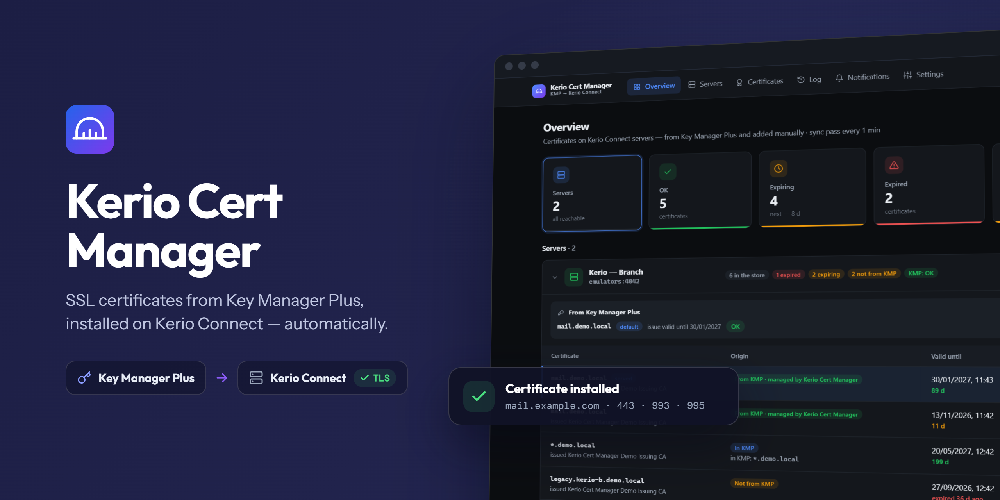
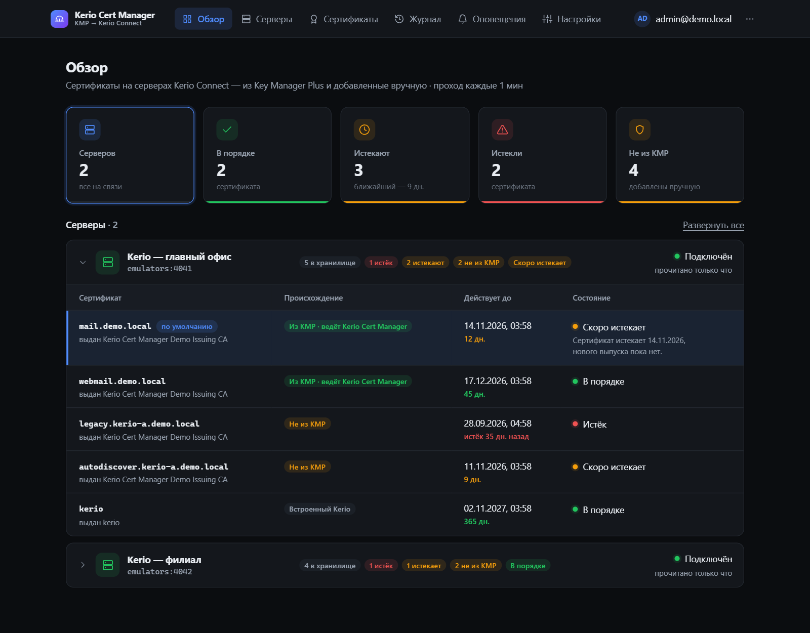
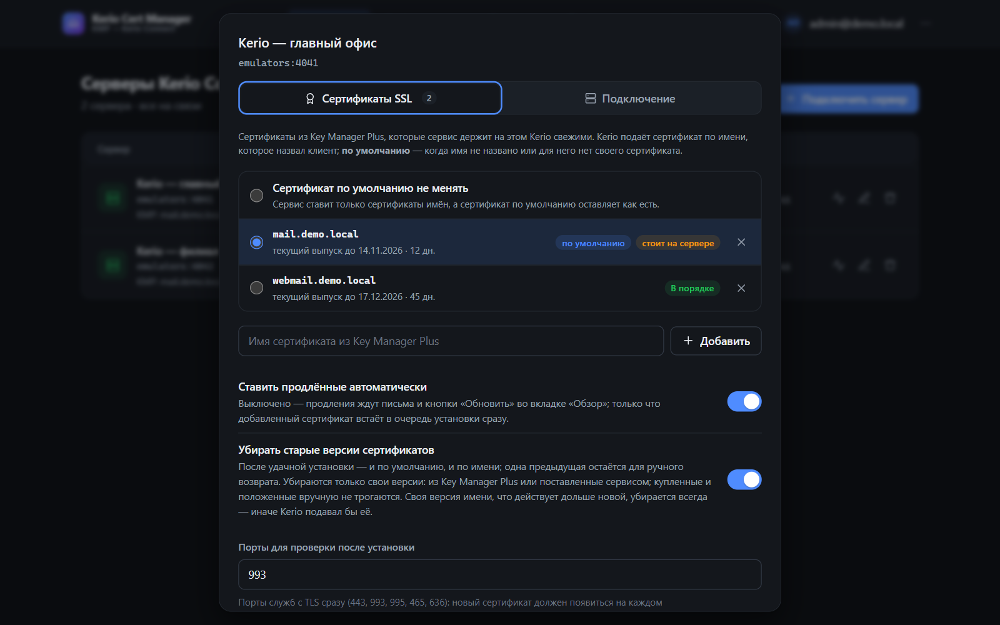
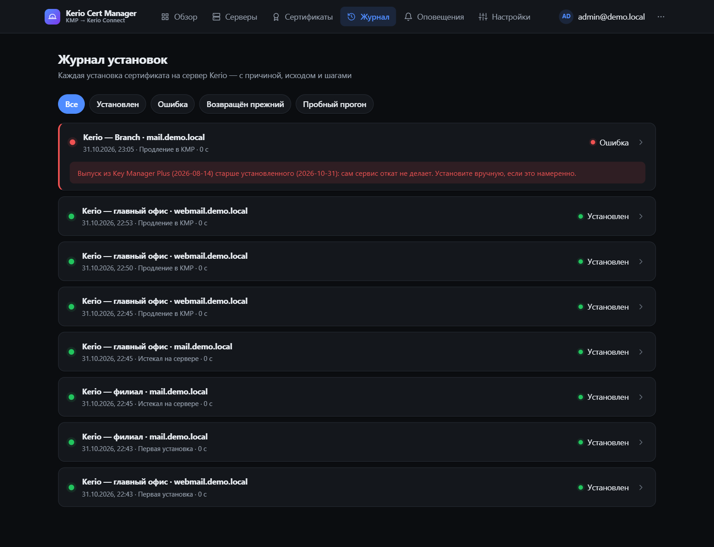
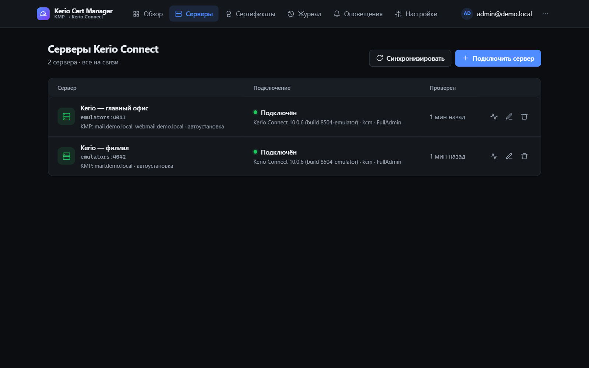
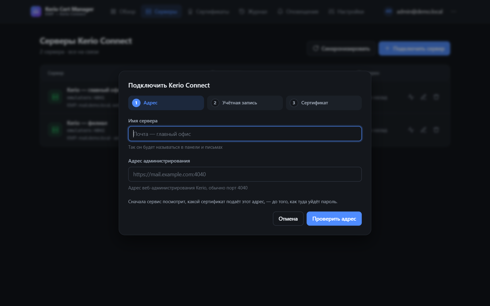
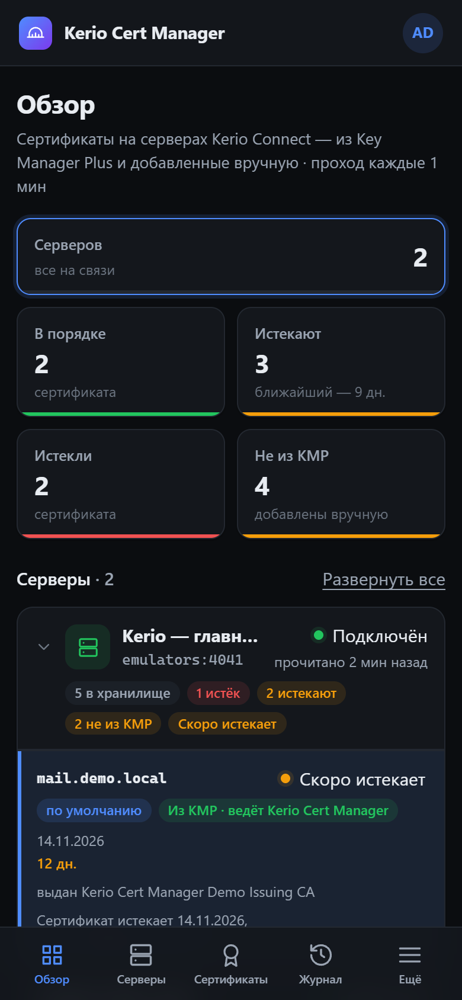
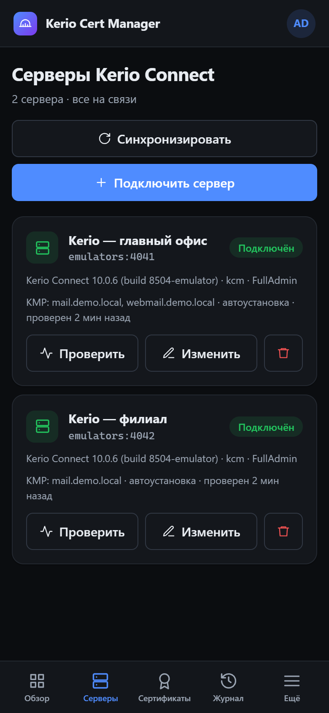
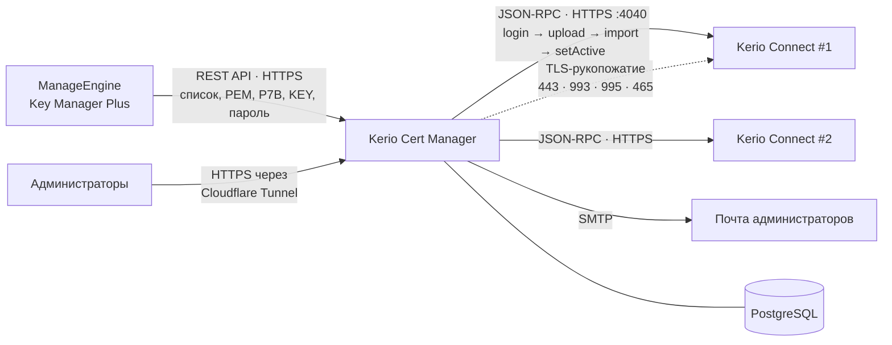
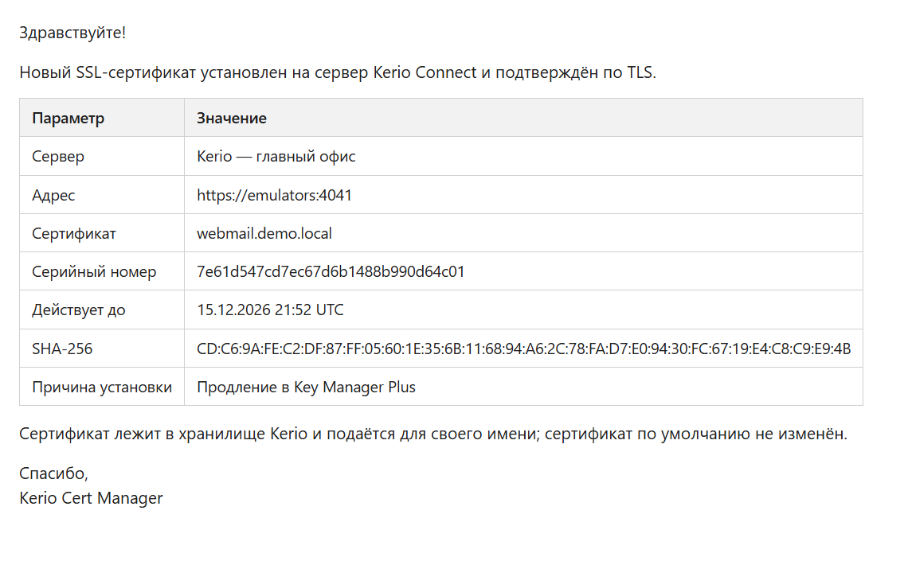

<p align="center">
  
</p>

<p align="center">
  <b>SSL-сертификаты из ManageEngine Key Manager Plus — на серверы Kerio Connect. Сами.</b><br>
  Сертификат продлили в Key Manager Plus — через минуты он стоит на каждом Kerio Connect, проверен по TLS на всех
  портах, а администраторы получили отчёт письмом.
</p>

<p align="center">
  <a href="LICENSE.ru.md"></a>
  
  
  
  
  
  
</p>

<p align="center">
  <a href="README.md">English</a> · <b>Русский</b>
</p>

<p align="center">
  
</p>

## Зачем

Сертификаты живут и продлеваются в ManageEngine Key Manager Plus (KMP), а на Kerio Connect их до сих пор ставят
руками: скачать ключ и сертификат, зайти в администрирование, импортировать, сделать сертификатом по умолчанию,
проверить каждый порт. Сроки сертификатов становятся всё короче — руками это перестаёт успевать.

Kerio Cert Manager делает это за вас:

- **замечает продление в KMP** — у того же Common Name появился новый серийный номер;
- **ставит его на каждый привязанный Kerio Connect** через API администрирования — по отдельной учётной записи сервиса;
- **проверяет результат рукопожатием TLS** на порту администрирования и портах служб (IMAPS, POP3S, SMTPS…) — с
  SNI и без;
- **возвращает прежний сертификат сам**, если новый не встал;
- **пишет администраторам**: что поставлено, что не получилось и почему, какой сертификат скоро истечёт.

## Возможности

| Возможность | Что даёт |
|---|---|
| **Много серверов Kerio** | У каждого — свой адрес, учётная запись, доверие TLS, сертификаты из KMP, порты проверки и получатели писем |
| **Сертификат по умолчанию и сертификаты имён** | Один сертификат сервера — *по умолчанию* (подаётся без SNI), остальные — *сертификаты имён*, их Kerio подаёт по SNI. Имена сверяются с KMP до сохранения |
| **Автоустановка** | По продлению в KMP и когда на сервере сертификат скоро истекает, а в KMP есть дольше действующий. Общий выключатель и выключатель каждого сервера |
| **Очередь установки** | Во всём сервисе сертификаты ставятся по одному: за проход — один на сервер, следующий проход — сразу после перезапуска HTTPS в Kerio. Первыми — нажатые, затем истёкшие, недостающие и истекающие раньше. Сертификатов на сервере — сколько угодно |
| **«Обновить»** / **«Добавить»** | В списке сервера во вкладке «Обзор», под состоянием сертификата, со свежим кодом второго фактора — только у сертификатов, выбранных для этого сервера: «Обновить», если в Key Manager Plus есть выпуск новее, «Добавить», если сертификата ещё нет в Kerio; по шагам в «Журнале» |
| **Проверка и откат** | После активации новый сертификат должен появиться на всех проверяемых портах; не появился — прежний возвращается и проверяется так же |
| **Пробный режим** | Всё проверяется — ключ, цепочка, вход в Kerio, хранилище, — но Kerio не меняется. Для первых дней |
| **Защиты** | Выпуск старше установленного сам не ставится; ручная правка на сервере не перебивается — только письмо; купленные и положенные вручную сертификаты сервис не удаляет |
| **Журнал установок** | Каждая установка: причина, исход, шаги со временем, отпечатки, идентификаторы в хранилище Kerio |
| **Письма** | Установлен, не установлен, скоро истекает, истёк, недоступен, пароль отвергнут, сертификат сменили вручную — без повторов чаще заданного |
| **Веб-панель** | **Обзор** — хранилище каждого Kerio: что подаётся, что из KMP, что положено вручную, что истекает. **Серверы** — связь, синхронизация, мастер подключения, правка, удаление с кодом 2FA. **Оповещения** — события, пороги, получатели, пробное письмо, история. Ещё: сертификаты KMP (только просмотр), журнал установок, журнал действий с выгрузкой CSV, настройки, пользователи. Работает и на телефоне |
| **Три языка** | Русский, английский, украинский — каждый выбирает свой в **Профиле**. На нём и панель, и тексты сервера (ошибки, шаги установки, состояния); у писем — свой язык |
| **Безопасность** | Пароль + приложение-аутентификатор (TOTP), свежий код перед опасными действиями, AES-256-GCM для всех секретов, строгий TLS к KMP, закреплённый отпечаток или УЦ для Kerio, журнал действий с цепочкой хешей |
| **Развёртывание** | Один закрытый образ в Docker Hub (`danreero/kerio_cert_manager`), PostgreSQL и Cloudflare Tunnel — без входящих портов на сервере. Удобно ставится в Portainer |

## Скриншоты

<table>
  <tr>
    <td width="50%"></td>
    <td width="50%"></td>
  </tr>
  <tr>
    <td align="center"><sub>Сервер: сертификат по умолчанию и сертификат имени из KMP</sub></td>
    <td align="center"><sub>Журнал установок: каждый шаг со временем</sub></td>
  </tr>
  <tr>
    <td></td>
    <td></td>
  </tr>
  <tr>
    <td align="center"><sub>Серверы: связь и действия</sub></td>
    <td align="center"><sub>Мастер подключения: адрес, учётная запись, сертификат</sub></td>
  </tr>
  <tr>
    <td colspan="2" align="center">&nbsp;&nbsp;&nbsp;</td>
  </tr>
  <tr>
    <td colspan="2" align="center"><sub>Панель на телефоне</sub></td>
  </tr>
</table>

## Как это работает



Проход синхронизации — раз в `keymanager.poll_minutes` (по умолчанию 15 минут) или по кнопке «Синхронизировать»:

1. **Опрос KMP** — список сертификатов: Common Name, серийный номер, срок. Продление — новый серийный у того же имени.
2. **Проверка каждого сервера** — что он подаёт по TLS (источник правды), пускает ли учётная запись в API, роль,
   версия Kerio, всё хранилище сертификатов.
3. **Решение** — в KMP новый выпуск привязанного имени, а сервер подаёт старый: установка.
4. **Установка**, каждый шаг — в журнал: выгрузка из KMP → проверка пары (ключ подходит, имя, срок, цепочка) →
   вход в Kerio → что подаётся сейчас → загрузка ключа и сертификата с цепочкой → импорт → активация
   (сертификат по умолчанию) → **проверка по TLS на всех портах** → откат при неудаче → уборка старых версий.
5. **Письма** администраторам и запись в журнале действий.

Особенности Kerio Connect 10.0.6, найденные на живом сервере и учтённые в коде, — в
[docs/KERIO-API.md](docs/KERIO-API.md).

## Что получают администраторы



Отчёт об установках (очередь из нескольких — одним сводным письмом) и предупреждения: скоро истекает (по умолчанию за 21, 7, 3 и 1 день), истёк, не обновился
сам, установка не удалась или откатилась, сервер недоступен, Kerio отверг пароль или проверку доверия, сертификат
сменили вручную, привязанный сертификат пропал из KMP. Верное предупреждение повторяется не чаще заданного.

## Что нужно

| Что | Зачем |
|---|---|
| Сервер Linux с Docker Engine и Compose v2 или Portainer | Сервис, база и туннель работают в контейнерах |
| Kerio Connect 9.0.2 и новее (проверено на 10.0.6) | Сертификаты по имени (SNI) появились в 9.0.2 |
| Отдельная учётная запись Kerio с правами **полного администратора** и **без** второго фактора | Под ней сервис входит в API администрирования |
| Key Manager Plus 7.1.1+ и его ключ REST API | Откуда берутся сертификаты |
| Почтовый ящик с доступом по SMTP | С него уходят отчёты и предупреждения |
| Домен в Cloudflare (или свой обратный прокси с TLS) | Панель наружу без входящих портов |

Серверу нужен исходящий доступ к Key Manager Plus (обычно `:6565`), к каждому Kerio Connect (`:4040` и порты служб,
которые надо проверять), к SMTP и к Cloudflare. Входящих портов не нужно.

## Установка через Portainer

Архив **`kerio-cert-manager-vX.Y.Z.zip`** из [Releases](../../releases) — всё для стека: `docker-compose.yml`,
`.env.example` с подсказками и пошаговый README. Стек сам скачает закрытый образ `danreero/kerio_cert_manager` из
Docker Hub, когда Portainer сможет туда войти.

1. **Registries → Add registry → DockerHub**: логин Docker Hub и токен доступа только для чтения.
2. Заполните `.env.example`: `KCM_MASTER_KEK` (`openssl rand -base64 32`), `POSTGRES_PASSWORD` и
   `KCM_APP_PASSWORD` (`openssl rand -hex 24`, разные), `CLOUDFLARE_TUNNEL_TOKEN`, `KCM_INIT_ADMIN_EMAIL` и
   `KCM_INIT_ADMIN_PASSWORD`.
3. **Stacks → Add stack** → имя `kerio-cert-manager` → **Upload** → `docker-compose.yml` →
   **Load variables from .env file** → **Deploy the stack**.
4. В Cloudflare у туннеля: **Public Hostname** → `HTTP` → `api:8001`. Включите Cloudflare Access (ниже).
5. В течение часа войдите администратором и подключите приложение-аутентификатор; затем очистите
   `KCM_INIT_ADMIN_PASSWORD` в переменных стека → **Update the stack**.

Стек превращает переменные в секреты Docker — в `docker inspect` их не видно. Служба `migrate` накатывает миграции
при каждом развёртывании; она же заводит первого администратора и может сбросить доступ (`KCM_RESET_ACCESS_*`, один
раз на пару «адрес + пароль») — в Portainer нет консоли. Подробно — [deploy/portainer/README.md](deploy/portainer/README.md).

## Установка из командной строки

С секретами в файлах, на сервере с Docker Compose v2.

**1. Файлы.** Скачайте `kerio-cert-manager-cli-vX.Y.Z.zip` из [Releases](../../releases) и распакуйте или
склонируйте репозиторий:

```bash
unzip kerio-cert-manager-cli-v*.zip && cd kerio-cert-manager
```

**2. Образ.** Образ в Docker Hub закрытый: войдите с токеном доступа только для чтения и скачайте его.

```bash
docker login -u ваш-логин-docker-hub
```

```bash
docker pull danreero/kerio_cert_manager:1.0.9
```

**3. Секреты.** Скрипт создаёт мастер-ключ шифрования и два пароля базы в `secrets/`. Существующие файлы не
перезаписывает.

```bash
./scripts/gen-secrets.sh
```

> Сохраните копию `secrets/kcm_master_kek` в надёжном месте, **отдельно** от копий базы. Без него не открыть пароли
> Kerio, ключ API KMP, пароль SMTP и секреты 2FA.

**4. Cloudflare Tunnel.** В Cloudflare: **Zero Trust → Networks → Tunnels → Create a tunnel** (тип Cloudflared).
Скопируйте токен из команды установки — длинную строку после `--token` — и вставьте в скрипт (ввод скрыт; токен
ложится в файл секрета, а не в `.env`):

```bash
cp .env.example .env
```

```bash
./scripts/set-tunnel-token.sh
```

Затем **Public Hostname → Add**: адрес панели (например `certs.example.com`), тип `HTTP`, URL `api:8001`.
`api:8001` — имя службы внутри Docker, а не адрес сервера; HTTPS для браузера даёт Cloudflare. Включите для домена
**Always Use HTTPS**.

**5. Cloudflare Access — только сотрудникам.** Без него страница входа открыта всему интернету.
**Zero Trust → Access → Applications → Add an application → Self-hosted**: домен панели, длительность сессии
`8 hours`, политика `Allow` для `Emails ending in @example.com` или группы из корпоративного провайдера учётных
записей. Пароль и код аутентификатора остаются второй линией защиты.

**6. База и первый администратор.** Пароль спросит со скрытым вводом.

```bash
docker compose run --rm migrate
```

```bash
docker compose run --rm api create-superadmin --email admin@example.com
```

**7. Запуск и проверка.**

```bash
docker compose up -d
```

```bash
curl -s http://127.0.0.1:8001/api/ready
```

Откройте `https://certs.example.com`, в течение часа войдите и подключите аутентификатор.

<details>
<summary>Без Cloudflare — свой обратный прокси</summary>

Закомментируйте `COMPOSE_PROFILES=tunnel` в `.env`. Сервис слушает только `127.0.0.1:8001` (другой порт —
`KCM_HTTP_PORT`); опубликуйте его через nginx, Caddy или Traefik **с HTTPS** — по открытому HTTP браузер сессию не
держит. Пример для Caddy:

```
certs.example.com {
    reverse_proxy 127.0.0.1:8001
}
```

Чтобы пределы частоты входа и журнал видели настоящий адрес клиента, задайте в `.env` адрес, с которого приходит
прокси (обычно шлюз сети Docker):

```
KCM_TRUSTED_PROXY_NETWORKS=172.18.0.1/32
```

</details>

## Настройка в панели

1. **Вход** — почта и пароль из установки, затем QR-код в приложение-аутентификатор (Google Authenticator,
   Microsoft Authenticator, Aegis, 1Password).
2. **Настройки → Почта** — сервер SMTP, порт и защита (`465` / `SSL/TLS` или `587` / `STARTTLS`), логин, пароль,
   адрес отправителя и адрес панели. Сохраните и отправьте **пробное письмо**.
3. **Настройки → Key Manager Plus** — адрес `https://kmp.example.com:6565` (имя из сертификата сервера, не IP) и
   ключ API из Key Manager Plus (**Settings → General Settings → API Key**). После сохранения статус станет
   **«Работает»** и покажет, сколько сертификатов видит сервис.
4. **Серверы → Подключить сервер** — для каждого Kerio Connect: адрес администрирования, учётная запись сервиса,
   какой сертификат KMP — по умолчанию, какие — сертификаты имён. Мастер покажет сертификат сервера до отправки
   пароля, проверит вход и сам найдёт порты служб.
5. **Оповещения** — какие события слать, пороги и получатели. **Пользователи** — пригласите коллег.

Первые дни можно включить **Настройки → Синхронизация → Пробный режим**: всё проверяется, Kerio не меняется.
Полное описание со скриншотами — в [руководстве пользователя](docs/USER-GUIDE.ru.md).

## Безопасность

- **Вход только со вторым фактором** (TOTP). Пределы частоты по адресу и учётной записи, блокировка после серии
  неудач. Первый администратор подключает аутентификатор в течение часа.
- **Свежий код перед опасными действиями**: подключение, правка и удаление сервера, смена доверия, ручная
  установка, ключ KMP, настройки оповещений, пользователи.
- **Закрыто по умолчанию**: без входа доступны только страницы входа и проверки здоровья.
- **Секреты зашифрованы** AES-256-GCM под мастер-ключом из файла: пароли Kerio, ключ API KMP, пароль SMTP, секреты
  TOTP. Пароль Kerio привязан к своему адресу и логину и никуда больше не уходит.
- **Закрытые ключи не хранятся**: ключ из KMP живёт в памяти одну установку и затирается после неё. Скачать
  сертификаты и ключи из сервиса нельзя.
- **TLS проверяется всегда**: к KMP — вся цепочка, имя и отзыв; к Kerio — закреплённый отпечаток или УЦ с именем.
  Отключить проверку нельзя. Адреса Kerio в loopback и link-local отвергаются.
- **Убираются только свои сертификаты**: уборка трогает версии из KMP и поставленные сервисом; купленные и
  положенные вручную остаются.
- **Контейнер**: образ chiseled без оболочки, не root, файловая система только для чтения, без возможностей Linux,
  без опубликованных портов, секреты файлами, образы закреплены по хешу.
- **База**: сервис работает ролью, которая только читает и пишет строки; пароль владельца схемы знает только
  `migrate`. Сеть базы — без выхода в интернет.
- **Журнал действий** в базе с цепочкой хешей, только на дописывание: кто вошёл, что изменил, что поставил, кому
  отказано.
- **Цепочка поставки**: каждый релиз проходит тесты, аудит зависимостей и проверку образа на уязвимости; образ
  публикуется с SBOM и данными о происхождении сборки.

Рекомендуется: Cloudflare Access перед панелью, отдельная учётная запись Kerio на каждый сервер, отдельная
учётная запись KMP для ключа API, закреплённая версия образа в `.env`.

## Обновление

```bash
docker compose pull
```

```bash
docker compose run --rm migrate
```

```bash
docker compose up -d
```

`migrate` обязателен после каждого обновления: на отставшей схеме сервис не стартует. Сначала снимите копию базы.
Что изменилось — в [журнале изменений](CHANGELOG.md).

## Копии и восстановление доступа

**Копия базы** (мастер-ключ храните отдельно):

```bash
mkdir -p backups && docker compose exec -T postgres pg_dump -U kcm kcm > backups/kcm.sql
```

**Потерян доступ** (забыт пароль, потерян телефон) — одна команда на сервере задаёт новый пароль (спросит дважды,
скрыто), снимает второй фактор и блокировку и закрывает все сессии:

```bash
./scripts/reset-access.sh admin@example.com
```

## Демо-стенд

Стенд на своём компьютере — с эмулятором Key Manager Plus и двух серверов Kerio Connect, для знакомства; ничего
настоящего не трогает:

```bash
git clone https://github.com/danrey-bilo/Kerio-Cert-Manager.git && cd Kerio-Cert-Manager
```

```bash
docker compose -f docker-compose.demo.yml up -d --build
```

Сервис берётся из Docker Hub (образ закрытый, сначала выполните `docker login`), на месте собирается только
эмулятор.

| Что | Адрес | Вход |
|---|---|---|
| Панель | http://localhost:18001 | `admin@demo.local` / `Demo-Admin-Passw0rd!`, затем аутентификатор |
| Панель стенда | http://localhost:18080 | Продлить сертификат в KMP, «залипнуть» Kerio, сменить роль |
| Письма (Mailpit) | http://localhost:18025 | — |

Затем **Настройки → Key Manager Plus** → ключ API `demo-api-key`; **Серверы → Подключить сервер** →
`https://emulators:4041`, логин `kcm`, пароль `Demo-Passw0rd!`. Демо-стенд использует опубликованный мастер-ключ и
стартует только с `KCM_DEMO_MODE=true`; с других компьютеров он недоступен.

## Документация

| Документ | Язык |
|---|---|
| [Руководство пользователя](docs/USER-GUIDE.ru.md) — установка, подготовка Kerio и KMP, каждый экран панели, оповещения, решение проблем | Русский |
| [User guide](docs/USER-GUIDE.md) — the same in English | Английский |
| [Справочник](docs/REFERENCE.md) — устройство, решения, настройки, REST API, данные, безопасность, команды | Русский |
| [API Kerio Connect](docs/KERIO-API.md) — какие методы API администрирования используются и как Kerio 10.0.6 ведёт себя на самом деле | Русский |
| [API Key Manager Plus](docs/KEYMANAGER-API.md) — какие методы REST API вызываются и что из них берётся | Русский |
| [Установка через Portainer](deploy/portainer/README.md) | Русский |
| [Журнал изменений](CHANGELOG.md) | Русский |
| [Политика безопасности](SECURITY.md) | Английский, русский |

## Лицензия

Kerio Cert Manager — **закрытое ПО**: пользоваться можно только с разрешения владельца, код конфиденциален. Полный
текст — [LICENSE](LICENSE) ([перевод](LICENSE.ru.md)).

| ✅ С разрешения владельца | ❌ Нельзя без письменного разрешения |
|---|---|
| Устанавливать и использовать официальные сборки в пределах разрешения | Смотреть и копировать исходный код целиком или частями |
| Хранить копии официальных сборок и править поставляемые файлы развёртывания для работы сервиса | Изменять код, собирать и запускать изменённые версии, восстанавливать код из сборок |
| Передавать их сотрудникам организации, которые эксплуатируют сервис | Распространять, продавать или сублицензировать код или сборки |

Kerio и Kerio Connect — товарные знаки их владельцев; ManageEngine и Key Manager Plus — товарные знаки Zoho
Corporation. Проект с ними не связан. Сторонние открытые компоненты внутри сборок — под своими лицензиями.

## Участие

Изменения кода не принимаются. Сообщения об ошибках и предложения присылайте владельцу этого репозитория; о
проблемах безопасности — см. [SECURITY.md](SECURITY.md).
