# Kerio Cert Manager — User guide

**English** · [Русский](USER-GUIDE.ru.md)

Kerio Cert Manager takes SSL certificates from ManageEngine Key Manager Plus (KMP) and installs them on Kerio
Connect servers by itself: it notices a renewal, installs the new certificate, checks it over TLS on every port,
rolls back if something goes wrong and e-mails the administrators. This guide walks through preparation,
installation and every screen of the web panel.

## Contents

1. [Concepts](#1-concepts)
2. [Before you start](#2-before-you-start)
3. [Installation](#3-installation)
4. [First sign-in](#4-first-sign-in)
5. [The panel at a glance](#5-the-panel-at-a-glance)
6. [Settings](#6-settings)
7. [Connecting a Kerio server](#7-connecting-a-kerio-server)
8. [Overview](#8-overview)
9. [Servers](#9-servers)
10. [Certificates](#10-certificates)
11. [Installation log](#11-installation-log)
12. [Notifications](#12-notifications)
13. [Users, audit log, security and profile](#13-users-audit-log-security-and-profile)
14. [Everyday operation](#14-everyday-operation)
15. [Troubleshooting](#15-troubleshooting)
16. [FAQ](#16-faq)

## 1. Concepts

**Source of certificates.** Certificates and their private keys are kept and renewed in Key Manager Plus. A
*renewal* is a new serial number for the same Common Name. Kerio Cert Manager reads KMP through its REST API and
never changes anything there.

**Default certificate and name certificates.** Since version 9.0.2, Kerio Connect keeps certificates for different
names and chooses one by the name the client asks for (SNI). One certificate is the **default** — Kerio serves it
when the client sends no name or when no certificate matches. For each server you choose:

- one KMP certificate as the **default** — the service installs it and makes it the default (`setActive`), or
  leaves the default alone;
- any number of **name certificates** — the service keeps their current release in the Kerio store; Kerio serves
  them to clients that ask for their name.

Choose as the default the certificate that covers the server's main name (its host name / MX name, for example
`mail.example.com`): mail servers delivering on port 25 and older clients often send no SNI and always get the
default.

**Sync pass.** Every `N` minutes (15 by default) the service polls KMP and checks every server: what it serves over
TLS, whether the account can sign in, what is in the certificate store. If KMP has a newer release of a linked
certificate than the server serves, the service installs it.

**Installation.** Export from KMP → key pair check → Kerio sign-in → upload and import → activation (for the
default certificate) → **TLS check on every verified port** → cleanup of old versions. If the new certificate does
not appear on every port in time, the service restores the previous one and checks that it is back.

**Dry run.** Everything is checked, but Kerio is not changed — useful for the first days.

## 2. Before you start

### 2.1 Kerio Connect

Kerio Connect 9.0.2 or newer is required (tested on 10.0.6). In **every** Kerio Connect create a dedicated account
for the service:

1. **Accounts → Users → Add**: for example `kcm`, a long random password.
2. **Rights**: **full administration** — only it allows importing certificates and making one the default.
3. **No second factor** for this account: the service signs in to the API with the password.

If Kerio rejects the password, the service stops signing in by itself (otherwise Kerio's lockout policy would block
the account) and sends an e-mail until the password is changed or **Check** is pressed.

Find out which ports serve TLS directly on this server — usually `443` (web mail, ActiveSync, EWS), `993` (IMAPS),
`995` (POP3S), `465` (SMTPS), `636` (LDAPS). The service will verify the new certificate on them. Ports with
STARTTLS (`25`, `587`, `143`, `110`) cannot be verified and are rejected.

### 2.2 Key Manager Plus

1. The certificates you want to install must be in KMP **with their private keys** (issued through KMP or imported
   with the key).
2. **Settings → General Settings → API Key → Generate** — the REST API key. Preferably create it under a dedicated
   KMP account with access to exactly these certificates.
3. KMP must be reachable over HTTPS from the service (usually port `6565`). If its certificate is issued by an
   internal CA, give the container the root certificate (`SSL_CERT_FILE`).

### 2.3 Mail and Cloudflare

- A mailbox with SMTP access for reports and warnings.
- A domain in Cloudflare for the panel (Cloudflare Tunnel — no inbound ports), or your own reverse proxy with HTTPS.

## 3. Installation

Installation is described step by step in the [README](../README.md#installation-with-portainer): with Portainer
(one stack file, secrets as stack variables) or from the command line (secrets in files). In short:

1. Generate the secrets: the master key and two database passwords. **Keep a copy of the master key separately
   from database backups.**
2. Put the Cloudflare Tunnel token into the secret file and point the tunnel's Public Hostname to `HTTP` `api:8001`.
3. `migrate` — the database schema and the first administrator.
4. `docker compose up -d` and open the panel address.

The image is public: `danreero/kerio_cert_manager` on Docker Hub. Pin a version in `KCM_IMAGE` and update it on
purpose.

## 4. First sign-in

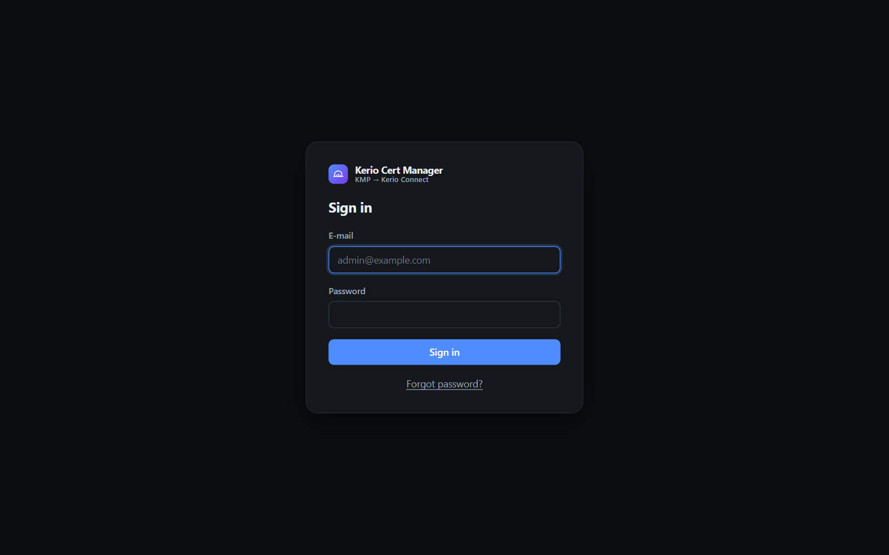

1. Open the panel address and sign in with the administrator's e-mail and password.
2. On the first sign-in the panel asks you to connect an **authenticator app** (Google Authenticator, Microsoft
   Authenticator, Aegis, 1Password): scan the QR code and enter the six digits. The first administrator must do
   this **within an hour** after being created; otherwise reset the access (section 15).
3. From now on every sign-in asks for the code from the app.

## 5. The panel at a glance

| Section | What it is for |
|---|---|
| **Overview** | Read-only: every Kerio server and every certificate in its store — what is served, what comes from KMP, what was placed by hand, what expires |
| **Servers** | Managing the connections: connect, check, edit, delete, sync, install now |
| **Certificates** | Certificates in KMP and which servers they go to |
| **Log** | The installation log: every installation with its steps |
| **Notifications** | Which events are e-mailed, thresholds, recipients, history |
| **Settings** | Synchronization, Key Manager Plus, e-mail |
| **⋯ menu** | Users, Audit log, Security, Profile, Sign out |

On a phone the sections move to the bottom bar; the layout depends on the browser mode (mobile or desktop), not on
the window width.

## 6. Settings

### 6.1 Synchronization

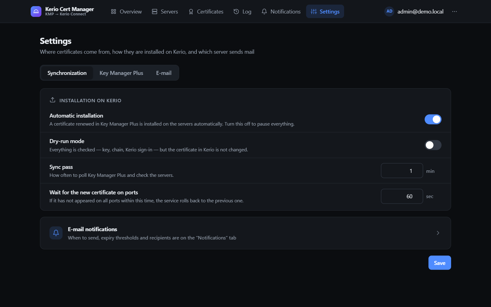

| Setting | Meaning |
|---|---|
| **Automatic installation** | A certificate renewed in KMP is installed on the servers by itself. Turned off — only e-mails and the **Install now** button. Each server also has its own switch |
| **Dry-run mode** | Everything is checked, Kerio is not changed. The log records a dry run instead of an installation |
| **Sync pass** | How often to poll KMP and check the servers, in minutes |
| **Wait for the new certificate on ports** | How long to wait for the new certificate on every verified port before rolling back, in seconds |

### 6.2 Key Manager Plus

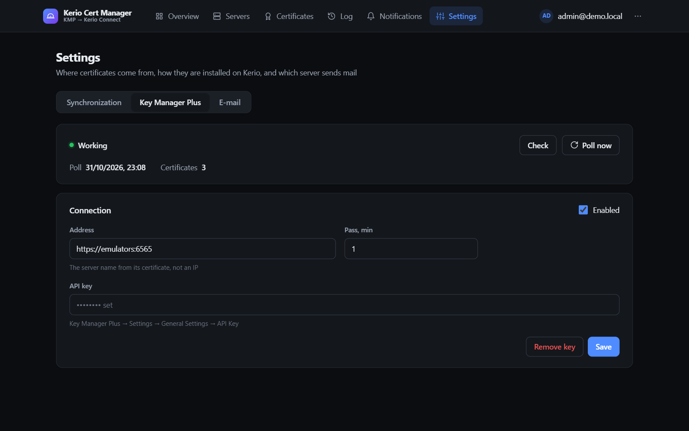

1. **Address** — `https://kmp.example.com:6565`. Use the name from KMP's certificate, not an IP: the TLS check
   compares the name and cannot be turned off.
2. **API key** — from KMP (**Settings → General Settings → API Key**). It is stored encrypted and is bound to the
   address: after changing the address you must enter the key again.
3. **Save.** The status card shows **Working**, the time of the last poll and how many certificates the service
   sees. **Poll now** polls immediately; **Remove key** stops the polling.

### 6.3 E-mail

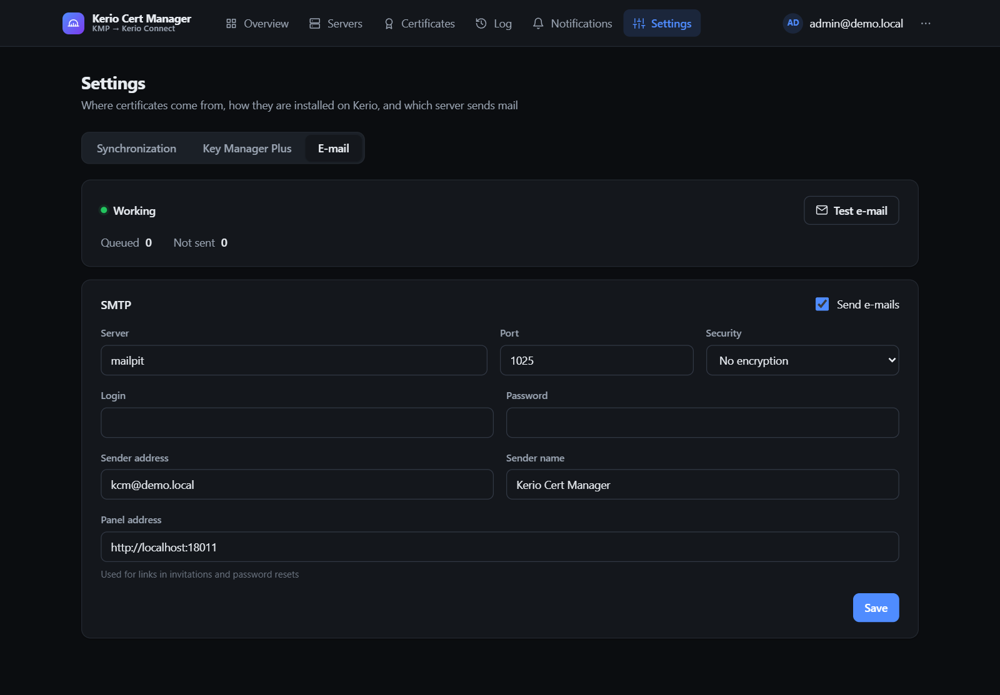

SMTP server, port and security (`465` + `SSL/TLS` or `587` + `STARTTLS`), login and password, sender address and
name, **Panel address** (used in links in invitations and password resets). Save and send a **Test e-mail**: the
status shows whether the server accepted it.

## 7. Connecting a Kerio server

**Servers → Connect server** opens a three-step wizard.

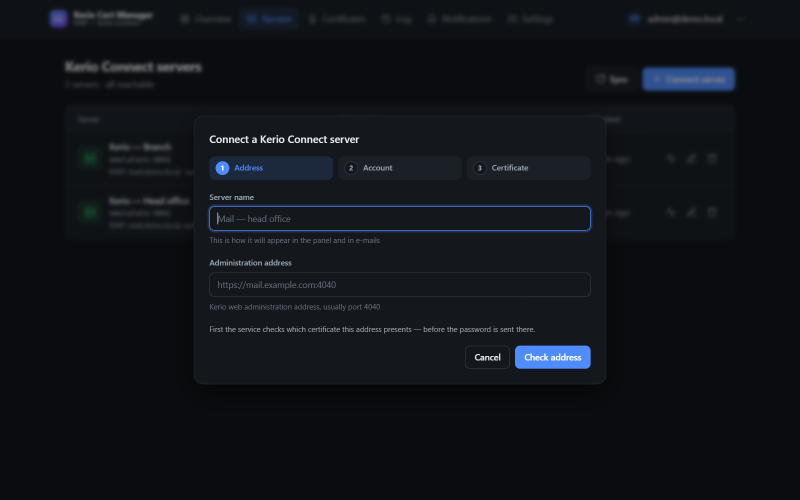

**Step 1 — Address.** A name for the panel and e-mails (for example *Kerio — Head office*) and the administration
address, usually `https://mail.example.com:4040`. **Check address** connects over TLS **before** any password is
sent and shows the server's certificate: subject, issuer, validity, SHA-256 fingerprint. The service also finds
which service ports (`443`, `993`, `995`, `465`, `636`) serve the same certificate — they become the ports to verify.

Choose how to trust Kerio's certificate:

- **Pinned fingerprint** — trust exactly this certificate (compare the fingerprint with the one shown in Kerio
  administration). After the service installs a new certificate, it re-pins it by itself.
- **Certificate authority** — a chain to a trusted root and the host name. If the address is an IP, enter the
  name from the certificate.

**Step 2 — Account.** The service account login and password. **Check** signs in to Kerio, shows the role (full
administration is required) and the Kerio version, and suggests the KMP certificate that is installed on the
server now. The password is stored encrypted and is sent only to this address and this login.

**Step 3 — Certificate.** Which KMP certificate is the default (or leave the default unchanged), which are name
certificates, the ports to verify, **Install renewed certificates automatically** and **Clean up old certificate
versions**. Every name is checked against the last KMP poll before saving.

The first check of the new server starts right away. If the server already serves the current KMP release, the
service simply adopts it; otherwise it installs it (or waits for **Install now** if automatic installation is off).

### 7.1 Editing a server

The pencil in the server row opens two tabs.

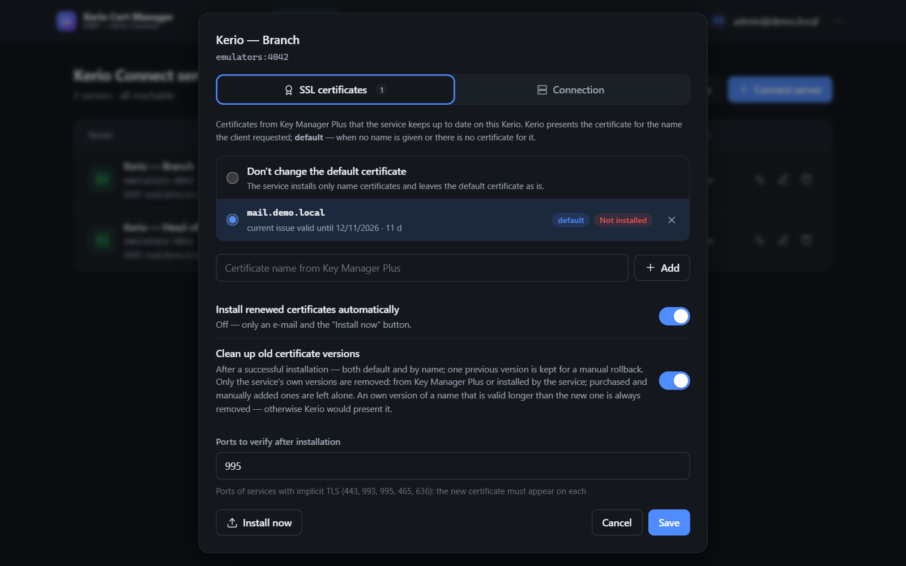

**SSL certificates** — the certificate list: the radio button marks the default, the cross removes a name
certificate from the list (the certificate stays in Kerio), **Add** adds a name from KMP. Badges show whether the
certificate is installed, served, or awaiting installation.

- **Install renewed certificates automatically** — turned off: only an e-mail and the **Install now** button.
- **Clean up old certificate versions** — after a successful installation the service removes *its own* previous
  versions of the same name (from KMP or installed by it) and keeps one previous version for a manual rollback.
  Certificates bought or placed by hand are never removed. An own version of a name certificate that is valid longer
  than the new one is always removed — otherwise Kerio would keep serving it.
- **Ports to verify after installation** — service ports with immediate TLS; the new certificate must appear on
  each of them. Keep only ports that are open and reachable from the service, otherwise every installation rolls
  back.

**Connection** — address, account, password and trust. Changing the address or the login requires the password
again; changing trust is a separate action with a fresh code.

Every change requires a fresh second-factor code. While a sync pass is processing the server, edits are refused
with *the server is being checked or updated — try again in a minute*.

## 8. Overview

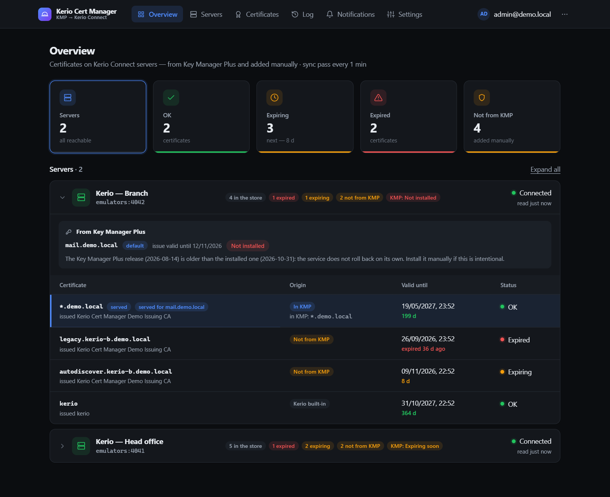

The tiles at the top are both the summary and the only filter: **Servers**, **OK**, **Expiring**, **Expired**,
**Not from KMP**. Click a tile to filter, click it again to clear.

Each server card shows the number of certificates in the store, problems, and the state of the linked KMP
certificates. Expanded, it lists:

- **From Key Manager Plus** — the linked certificates: which one is the default, the current release in KMP and its
  state (*OK*, *Awaiting installation*, *Not installed* with the reason).
- **The store** — every certificate in Kerio: *served* (the default) and *served for name*, its origin
  (**From KMP · managed by Kerio Cert Manager**, **In KMP**, **Not from KMP**, **Kerio built-in**), valid until and
  state.

## 9. Servers

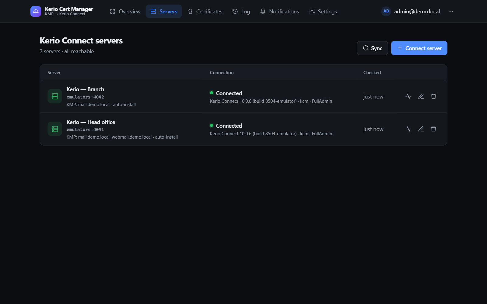

| Element | Meaning |
|---|---|
| **Connected** / **Unreachable** / **Working…** | Connection state; *Working…* — a sync pass is processing the server now |
| ⚡ **Check** | Check the connection and the sign-in now (also after Kerio rejected the password) |
| ✏ **Edit** | Certificates and connection (section 7.1) |
| 🗑 **Delete** | Stop managing the server. Asks for a fresh code every time. Nothing changes on Kerio; the installation history stays |
| **Sync** | Run a sync pass now: KMP poll and check of every server |
| **Install now** | In the server's edit dialog (pencil) when a renewal is waiting: install with a fresh code, step by step |

## 10. Certificates

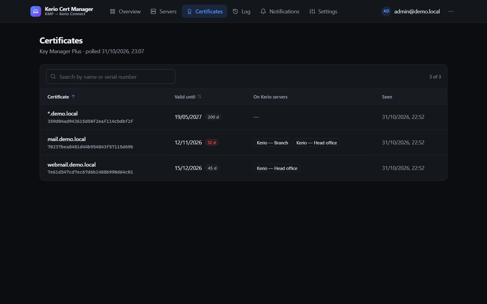

Certificates from the last KMP poll: Common Name, serial, expiry, days left, and the servers they are linked to
(as the default or by name). View only — the service never offers certificates or keys for download.

## 11. Installation log

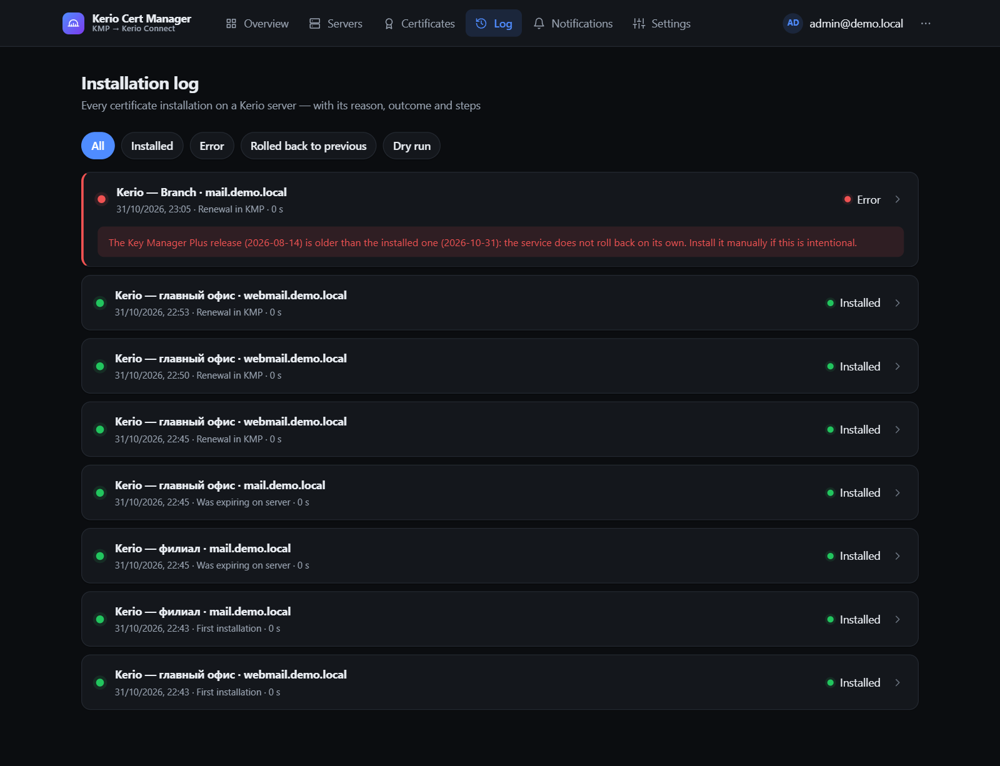

Every installation: server, certificate, time, reason (*First installation*, *Renewal in KMP*, *Was expiring on
server*, *Manual*, *Retry*), outcome (**Installed**, **Error**, **Rolled back to previous**, **Dry run**) and duration. Click
an installation to see its steps with timestamps, the serial number, the SHA-256 fingerprint and the id in the
Kerio store. The filters at the top select by outcome.

## 12. Notifications

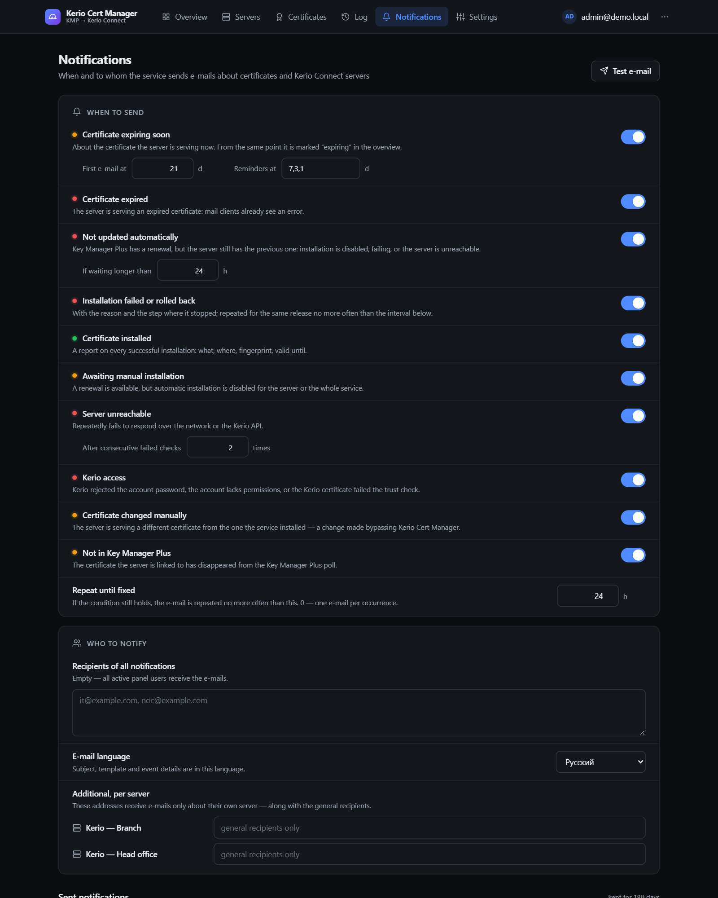

**When to send** — each event has a switch:

| Event | When |
|---|---|
| Certificate expiring soon | The certificate the server serves expires within *First e-mail at* days (21 by default), then reminders (7, 3, 1) |
| Certificate expired | The server serves an expired certificate |
| Not updated automatically | KMP has a renewal, but the server still has the previous one after *N* hours |
| Installation failed or rolled back | With the reason and the step where it stopped |
| Certificate installed | A report on every successful installation |
| Awaiting manual installation | A renewal is available, but automatic installation is off |
| Server unreachable | After *N* consecutive failed checks |
| Kerio access | Kerio rejected the password, the account lacks rights, or the certificate failed the trust check |
| Certificate changed manually | The server serves a different certificate from the one the service installed |
| Not in Key Manager Plus | The linked certificate disappeared from the KMP poll |

**Repeat until fixed** — a warning that is still true is repeated no more often than this (0 — once per
occurrence).

**Who to notify** — recipients of all notifications (empty — all active panel users), **E-mail language**
(subject, template and event details), and additional recipients per server.

**Test e-mail** checks the whole path; **Sent notifications** at the bottom keeps the history for 180 days.
Changing notification settings requires a fresh code.

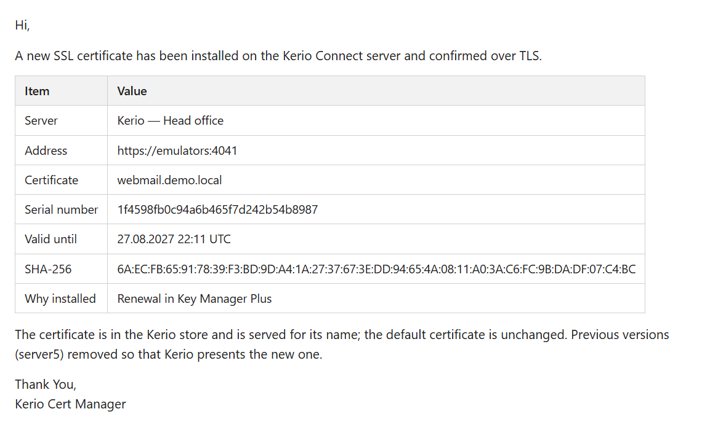

## 13. Users, audit log, security and profile

**Users** — invite colleagues by e-mail (or pass the invitation link yourself if mail is not configured); each sets
their own password and authenticator. For each user: rename, invite again, password reset link, unblock, reset 2FA,
end sessions, disable or delete.

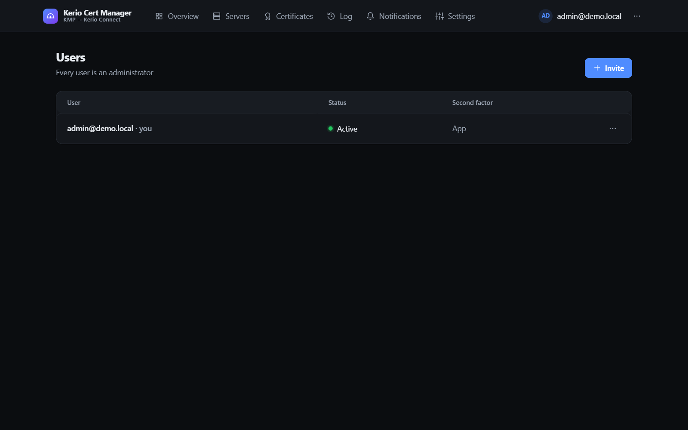

**Audit log** — who signed in, what changed (with old and new values), who installed what, who was denied.
The log is append-only and hash-chained; **Export CSV** downloads it.

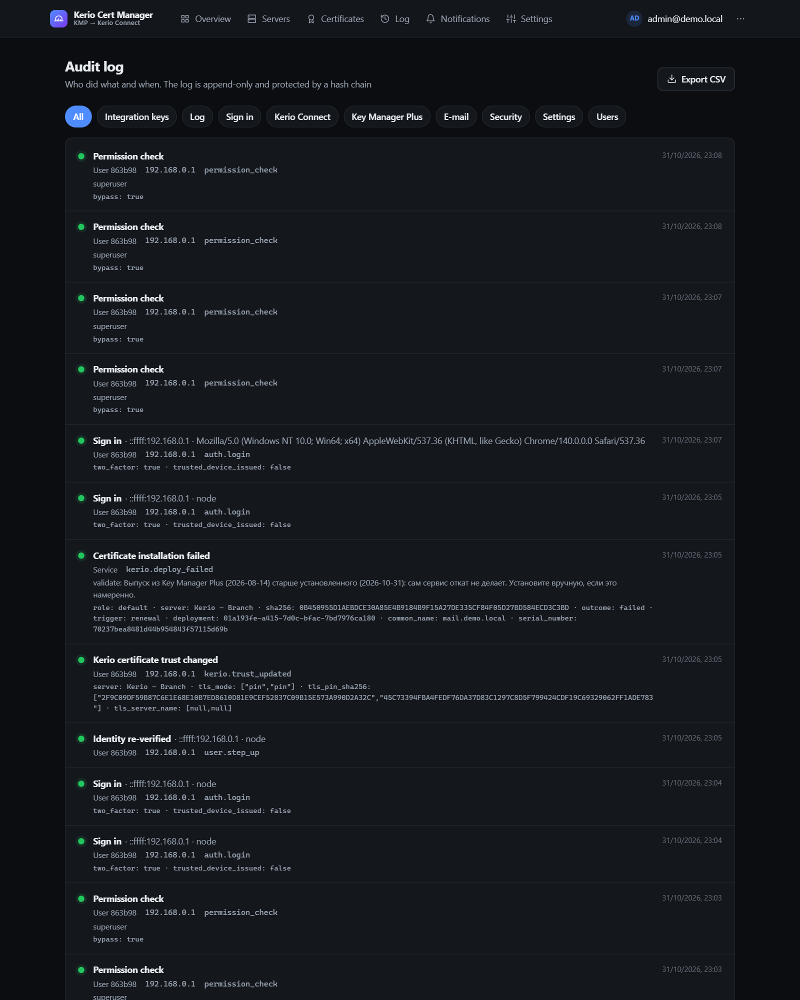

**Security** — how long a confirmed code is valid for sensitive actions, sign-in attempts before lockout and the
lockout time, time to enter the code, idle timeout and maximum session length, password policy, invitation link
lifetime and the e-mail rate limit per address.

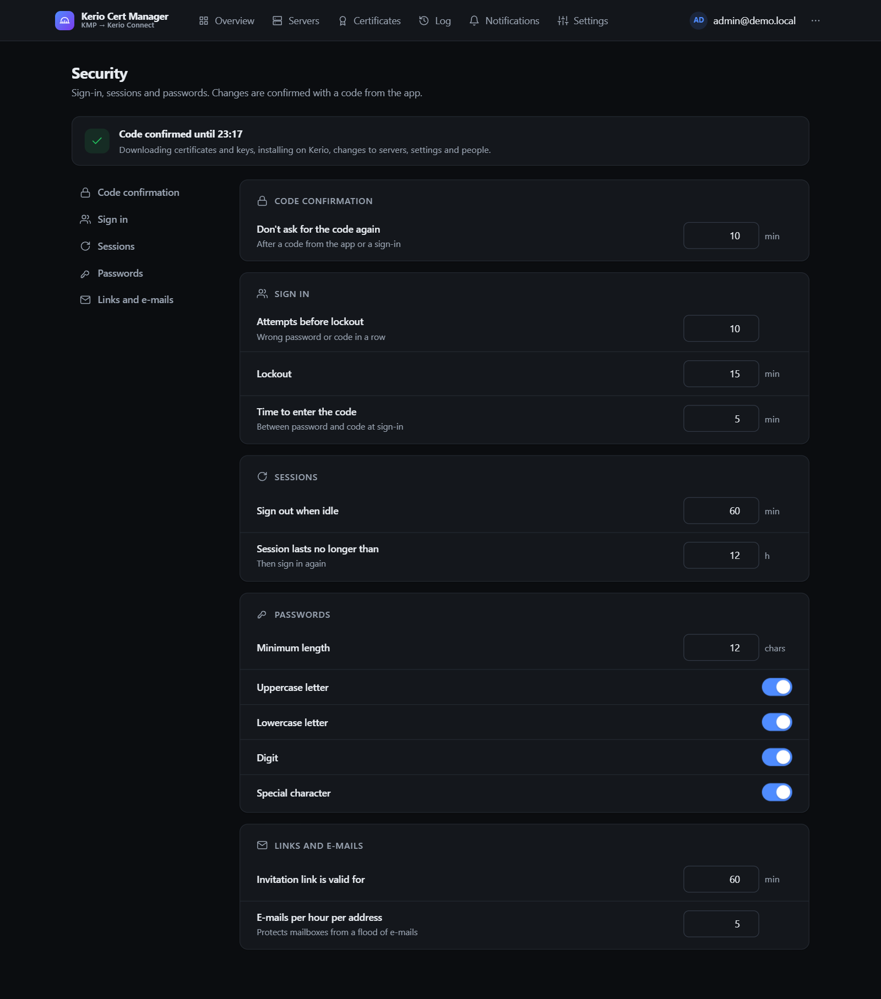

**Profile** — your name, the **interface language** (English, Ukrainian, Russian — applies to the panel and to
server texts and follows you to any device), password change, second factor and active sessions (end any session
other than the current one).

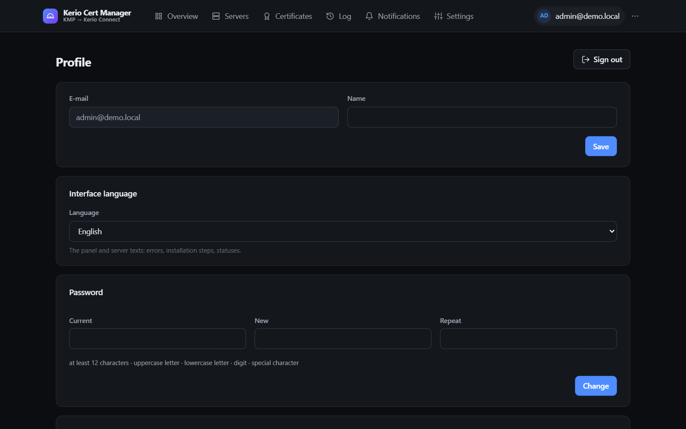

## 14. Everyday operation

- **A certificate is renewed in KMP.** Within one sync pass the service notices it and installs it on every server
  that uses it (or e-mails *Awaiting manual installation* if automatic installation is off), then e-mails a report.
- **Install now.** Servers → pencil → **Install now** with a fresh code. Also installs an older release
  if you decide so (the service never does this by itself).
- **Rollback.** If the new certificate does not appear on every verified port, the previous one is restored and
  verified; the log shows **Rolled back to previous** and an e-mail explains why. The next attempt waits for a
  back-off interval.
- **Dry run.** Turn on **Settings → Synchronization → Dry-run mode** to see what would happen without touching Kerio.
- **Updating the service.** `docker compose pull`, `docker compose run --rm migrate`, `docker compose up -d` (or
  a new `KCM_IMAGE` in Portainer). Take a database backup first.

## 15. Troubleshooting

| Symptom | What to do |
|---|---|
| **The Kerio certificate failed the trust check** | The certificate on the administration port changed outside the service, or the pinned fingerprint is wrong. Compare the fingerprint in Kerio administration and set it again on the **Connection** tab |
| **Kerio rejected the password** | The service stopped signing in to avoid an account lockout. Set the new password on the **Connection** tab or press **Check** |
| **The account lacks rights** | The service account needs full administration in Kerio |
| **Key Manager Plus: Error** | Check the address (a name from the certificate, not an IP), the API key and reachability of port 6565. For an internal CA, give the container the root (`SSL_CERT_FILE`) |
| **Every installation rolls back** | One of the verified ports does not answer or serves something else. Remove closed ports from the list or open them for the service |
| **Not installed: the KMP release is older than the installed one** | Protection against rollback. If this is intentional, use **Install now** |
| **A name certificate is installed but not served** | A version of the same name that is valid longer is in the store and is not the service's own (bought or placed by hand). Remove it in Kerio if it is no longer needed |
| **The address points to the service itself or a reserved network** | Kerio cannot be on loopback or link-local addresses; use the server's real address |
| **Lost access** | `./scripts/reset-access.sh admin@example.com` on the server (Portainer: `KCM_RESET_ACCESS_EMAIL` / `KCM_RESET_ACCESS_PASSWORD`, then clear them) |
| **The service does not start after an update** | Run `docker compose run --rm migrate`: the service refuses to start on an outdated schema |

Container logs: `docker compose logs api` (structured JSON, without secrets).

## 16. FAQ

**Does the service delete certificates from Kerio?** Only its own old versions (from KMP or installed by it), and
only after a successful installation, keeping one previous version. Certificates bought or placed by hand are never
removed.

**Where are the private keys stored?** Nowhere. A key is fetched from KMP for one installation, kept in memory and
wiped afterwards. Passwords and the API key are stored encrypted with AES-256-GCM under the master key.

**Why can't I add port 25 or 587?** They use STARTTLS: a plain TLS handshake is impossible there, so the result
cannot be verified. Kerio serves the same certificate store on them anyway.

**Which certificate should be the default?** The one that covers the server's host name / MX name (for example
`mail.example.com`, or a wildcard `*.example.com` plus `example.com`): clients without SNI always get the default.

**Can several Kerio servers use one certificate?** Yes — link the same KMP certificate to each of them; each server
is installed and verified separately.

**Can I run two instances of the service?** The sync pass takes a lease on each server, so two processes never
install on the same server at once. Keep `KCM_RUN_WORKER=true` on one instance.
