# Kerio Cert Manager — руководство пользователя

[English](USER-GUIDE.md) · **Русский**

Kerio Cert Manager берёт SSL-сертификаты из ManageEngine Key Manager Plus (KMP) и сам ставит их на серверы Kerio
Connect: замечает продление, ставит новый сертификат, проверяет его по TLS на всех портах, при неудаче возвращает
прежний и пишет администраторам. Здесь — подготовка, установка и каждый экран веб-панели.

## Содержание

1. [Основные понятия](#1-основные-понятия)
2. [Подготовка](#2-подготовка)
3. [Установка](#3-установка)
4. [Первый вход](#4-первый-вход)
5. [Панель в целом](#5-панель-в-целом)
6. [Настройки](#6-настройки)
7. [Подключение сервера Kerio](#7-подключение-сервера-kerio)
8. [Обзор](#8-обзор)
9. [Серверы](#9-серверы)
10. [Сертификаты](#10-сертификаты)
11. [Журнал установок](#11-журнал-установок)
12. [Оповещения](#12-оповещения)
13. [Пользователи, журнал действий, безопасность и профиль](#13-пользователи-журнал-действий-безопасность-и-профиль)
14. [Повседневная работа](#14-повседневная-работа)
15. [Если что-то не так](#15-если-что-то-не-так)
16. [Вопросы и ответы](#16-вопросы-и-ответы)

## 1. Основные понятия

**Откуда сертификаты.** Сертификаты и их закрытые ключи хранятся и продлеваются в Key Manager Plus. *Продление* —
новый серийный номер у того же Common Name. Kerio Cert Manager читает KMP через REST API и ничего там не меняет.

**Сертификат по умолчанию и сертификаты имён.** Начиная с 9.0.2 Kerio Connect хранит сертификаты разных имён и
выбирает по имени, которое назвал клиент (SNI). Один сертификат — **по умолчанию**: его Kerio подаёт, когда клиент
имя не назвал или своего сертификата у имени нет. Для каждого сервера вы выбираете:

- один сертификат KMP **по умолчанию** — сервис ставит его и делает сертификатом по умолчанию (`setActive`) или не
  трогает сертификат по умолчанию вовсе;
- сколько угодно **сертификатов имён** — сервис держит в хранилище Kerio их текущий выпуск; Kerio подаёт их тем,
  кто спрашивает это имя.

По умолчанию выбирайте сертификат, который покрывает главное имя сервера (его hostname / имя из MX, например
`mail.example.com`): почтовые серверы, доставляющие на порт 25, и старые клиенты часто не передают SNI и всегда
получают сертификат по умолчанию.

**Проход синхронизации.** Раз в `N` минут (по умолчанию 15) сервис опрашивает KMP и проверяет каждый сервер: что он
подаёт по TLS, пускает ли учётная запись, что лежит в хранилище. Если в KMP выпуск привязанного сертификата новее
того, что подаёт сервер, — установка.

**Установка.** Выгрузка из KMP → проверка пары → вход в Kerio → загрузка и импорт → активация (для сертификата по
умолчанию) → **проверка по TLS на каждом проверяемом порту** → уборка старых версий. Не появился новый сертификат
на всех портах вовремя — сервис возвращает прежний и проверяет, что он вернулся.

**Пробный режим.** Всё проверяется, но Kerio не меняется — для первых дней.

## 2. Подготовка

### 2.1 Kerio Connect

Нужен Kerio Connect 9.0.2 и новее (проверено на 10.0.6). В **каждом** Kerio Connect заведите отдельную учётную
запись для сервиса:

1. **Accounts → Users → Add**: например `kcm`, длинный случайный пароль.
2. **Права**: **полное администрирование** — только оно позволяет импортировать сертификаты и делать сертификат
   сертификатом по умолчанию.
3. **Без второго фактора** — сервис входит в API паролем.

Если Kerio отверг пароль, сервис перестаёт входить сам (иначе политика блокировки Kerio заблокировала бы учётную
запись) и пишет письмо — до смены пароля или нажатия **«Проверить»**.

Выясните, какие порты этого сервера сразу говорят по TLS: обычно `443` (веб-почта, ActiveSync, EWS), `993` (IMAPS),
`995` (POP3S), `465` (SMTPS), `636` (LDAPS). На них сервис проверит новый сертификат. Порты со STARTTLS (`25`, `587`,
`143`, `110`) проверить нельзя — они отвергаются.

### 2.2 Key Manager Plus

1. Нужные сертификаты должны быть в KMP **с закрытыми ключами** (выпущены через KMP или импортированы вместе с ключом).
2. **Settings → General Settings → API Key → Generate** — ключ REST API. Лучше — от отдельной учётной записи KMP с
   доступом ровно к этим сертификатам.
3. KMP должен быть доступен сервису по HTTPS (обычно порт `6565`). Если его сертификат выдан внутренним УЦ, дайте
   контейнеру корневой сертификат (`SSL_CERT_FILE`).

### 2.3 Почта и Cloudflare

- Почтовый ящик с доступом по SMTP — для отчётов и предупреждений.
- Домен в Cloudflare для панели (Cloudflare Tunnel — без входящих портов) или свой обратный прокси с HTTPS.

## 3. Установка

Установка по шагам — в [README](../README.ru.md#установка-через-portainer): через Portainer (один файл стека,
секреты — переменными стека) или из командной строки (секреты в файлах). Коротко:

1. Создайте секреты: мастер-ключ и два пароля базы. **Копию мастер-ключа храните отдельно от копий базы.**
2. Положите токен Cloudflare Tunnel в файл секрета, Public Hostname туннеля — `HTTP` `api:8001`.
3. `migrate` — схема базы и первый администратор.
4. `docker compose up -d` и откройте адрес панели.

Образ открытый: `danreero/kerio_cert_manager` в Docker Hub. Закрепите версию в `KCM_IMAGE` и обновляйте
осознанно.

## 4. Первый вход

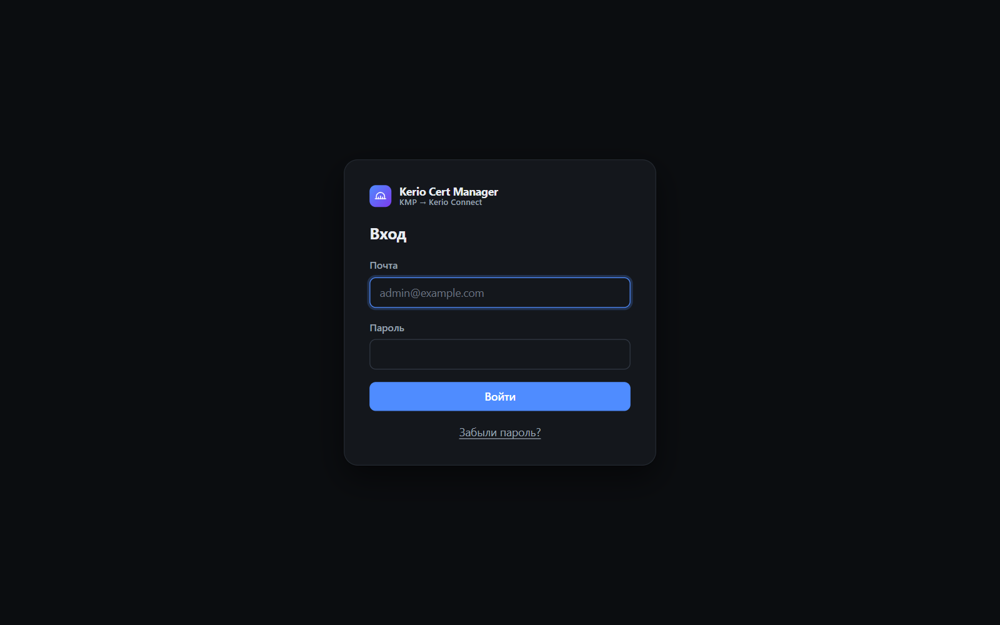

1. Откройте адрес панели и войдите почтой и паролем администратора.
2. При первом входе панель попросит подключить **приложение-аутентификатор** (Google Authenticator, Microsoft
   Authenticator, Aegis, 1Password): отсканируйте QR-код и введите шесть цифр. Первый администратор должен сделать
   это **в течение часа** после создания; иначе — сброс доступа (раздел 15).
3. Дальше каждый вход спрашивает код из приложения.

## 5. Панель в целом

| Раздел | Для чего |
|---|---|
| **Обзор** | Только просмотр: каждый сервер Kerio и каждый сертификат в его хранилище — что подаётся, что из KMP, что положено вручную, что истекает |
| **Серверы** | Управление подключениями: подключить, проверить, изменить, удалить, синхронизировать, установить сейчас |
| **Сертификаты** | Сертификаты в KMP и на какие серверы они уходят |
| **Журнал** | Журнал установок: каждая установка по шагам |
| **Оповещения** | Какие события слать письмом, пороги, получатели, история |
| **Настройки** | Синхронизация, Key Manager Plus, почта |
| **Меню ⋯** | Пользователи, журнал действий, безопасность, профиль, выход |

На телефоне разделы — в нижней панели; раскладка зависит от режима браузера (мобильный или десктопный), а не от
ширины окна.

## 6. Настройки

### 6.1 Синхронизация

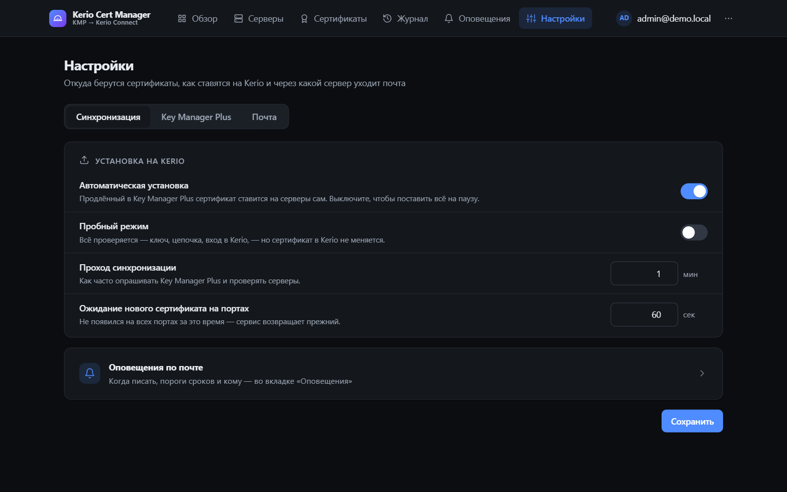

| Настройка | Что значит |
|---|---|
| **Автоматическая установка** | Продлённый в KMP сертификат ставится на серверы сам. Выключено — только письма и кнопка **«Обновить»**. У каждого сервера — ещё свой выключатель |
| **Пробный режим** | Всё проверяется, Kerio не меняется. В журнале — пробный прогон вместо установки |
| **Проход синхронизации** | Как часто опрашивать KMP и проверять серверы, минуты |
| **Ожидание нового сертификата на портах** | Сколько ждать нового сертификата на всех проверяемых портах до отката, секунды |

### 6.2 Key Manager Plus

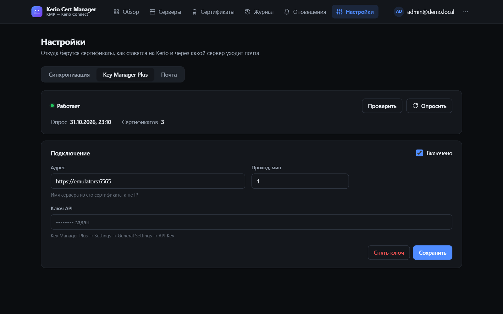

1. **Адрес** — `https://kmp.example.com:6565`. Имя — из сертификата KMP, не IP: проверка TLS сверяет имя и не
   отключается.
2. **Ключ API** — из KMP (**Settings → General Settings → API Key**). Хранится зашифрованным и привязан к адресу:
   сменили адрес — введите ключ заново.
3. **«Сохранить».** Карточка состояния покажет **«Работает»**, время последнего опроса и сколько сертификатов видит
   сервис. **«Опросить»** — опрос сразу; **«Снять ключ»** — прекратить опрос.

### 6.3 Почта

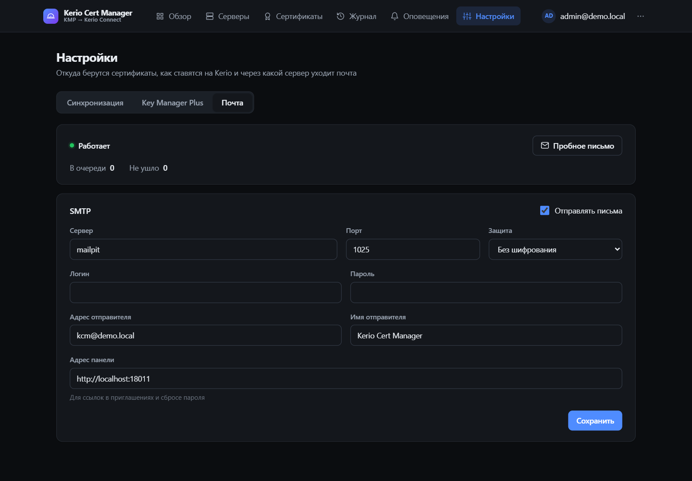

Сервер SMTP, порт и защита (`465` + `SSL/TLS` или `587` + `STARTTLS`), логин и пароль, адрес и имя отправителя,
**адрес панели** (для ссылок в приглашениях и сбросе пароля). Сохраните и отправьте **тестовое письмо**: состояние
покажет, принял ли его сервер.

## 7. Подключение сервера Kerio

**Серверы → «Подключить сервер»** открывает мастер из трёх шагов.

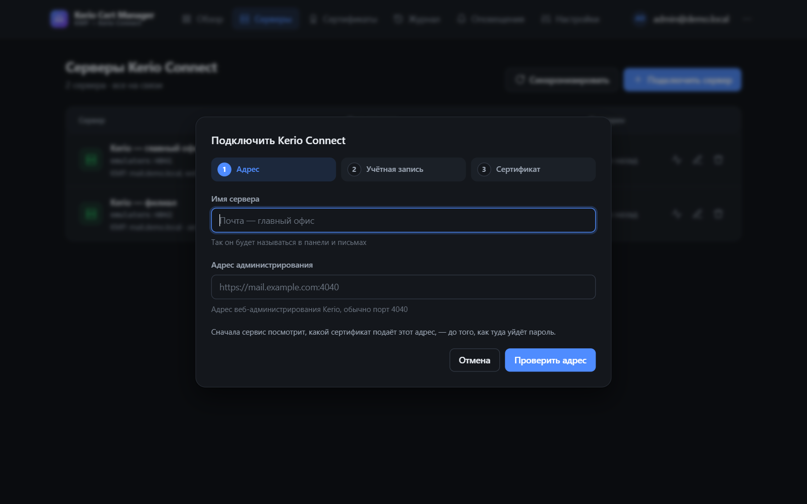

**Шаг 1 — Адрес.** Имя для панели и писем (например *Kerio — главный офис*) и адрес администрирования, обычно
`https://mail.example.com:4040`. **«Проверить адрес»** соединяется по TLS **до** отправки пароля и показывает
сертификат сервера: субъект, издатель, срок, отпечаток SHA-256. Заодно сервис находит, какие порты служб (`443`,
`993`, `995`, `465`, `636`) подают тот же сертификат, — они станут портами проверки.

Выберите, как доверять сертификату Kerio:

- **Закреплённый отпечаток** — доверять ровно этому сертификату (сверьте отпечаток с показанным в администрировании
  Kerio). Поставив новый сертификат, сервис перезакрепит его сам.
- **Центр сертификации** — цепочка до доверенного корня и имя. Если адрес — IP, впишите имя из сертификата.

**Шаг 2 — Учётная запись.** Логин и пароль учётной записи сервиса. **«Проверить»** входит в Kerio, показывает роль
(нужно полное администрирование) и версию Kerio и предлагает сертификат KMP, который стоит на сервере сейчас. Пароль
хранится зашифрованным и уходит только на этот адрес и этот логин.

**Шаг 3 — Сертификат.** Какой сертификат KMP — по умолчанию (или не менять сертификат по умолчанию), какие —
сертификаты имён, порты проверки, **«Ставить продлённые автоматически»** и **«Убирать старые версии
сертификатов»**. Каждое имя сверяется с последним опросом KMP до сохранения.

Первая проверка нового сервера начинается сразу. Если сервер уже подаёт текущий выпуск KMP, сервис просто признаёт
его своим; иначе ставит (или ждёт **«Обновить»**, если автоустановка выключена).

### 7.1 Правка сервера

Карандаш в строке сервера открывает две вкладки.

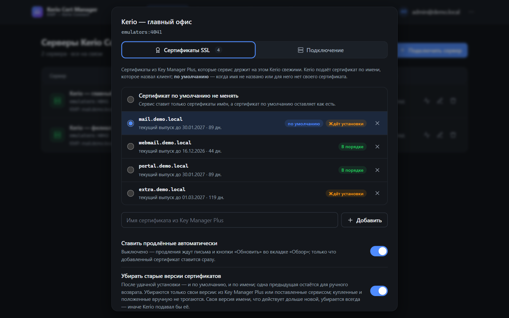

**Сертификаты SSL** — список сертификатов: переключатель отмечает сертификат по умолчанию, крестик убирает
сертификат имени из списка (в Kerio сертификат остаётся), **«Добавить»** — имя из KMP. Метки показывают, стоит ли
сертификат, подаётся ли он, ждёт ли установки.

- **Ставить продлённые автоматически** — выключено: продления ждут письма и кнопки **«Обновить»**. Только что
  добавленный в список сертификат ставится сразу и так; держит его только общая пауза.
- **Убирать старые версии сертификатов** — после удачной установки сервис убирает *свои* прежние версии того же
  имени (из KMP или поставленные им) и оставляет одну предыдущую для ручного возврата. Купленные и положенные
  вручную сертификаты не трогаются никогда. Своя версия сертификата имени, что действует дольше новой, убирается
  всегда — иначе Kerio подавал бы её.
- **Порты для проверки после установки** — порты служб с TLS сразу; новый сертификат должен появиться на каждом.
  Оставьте только открытые и доступные сервису порты, иначе каждая установка будет откатываться.

**Подключение** — адрес, учётная запись, пароль и доверие. Смена адреса или логина требует пароль заново; смена
доверия — отдельное действие со свежим кодом.

Любая правка требует свежего кода второго фактора. Пока сервер обрабатывает проход синхронизации, правка
отклоняется: *сервер сейчас проверяется или обновляется — повторите через минуту*.

## 8. Обзор

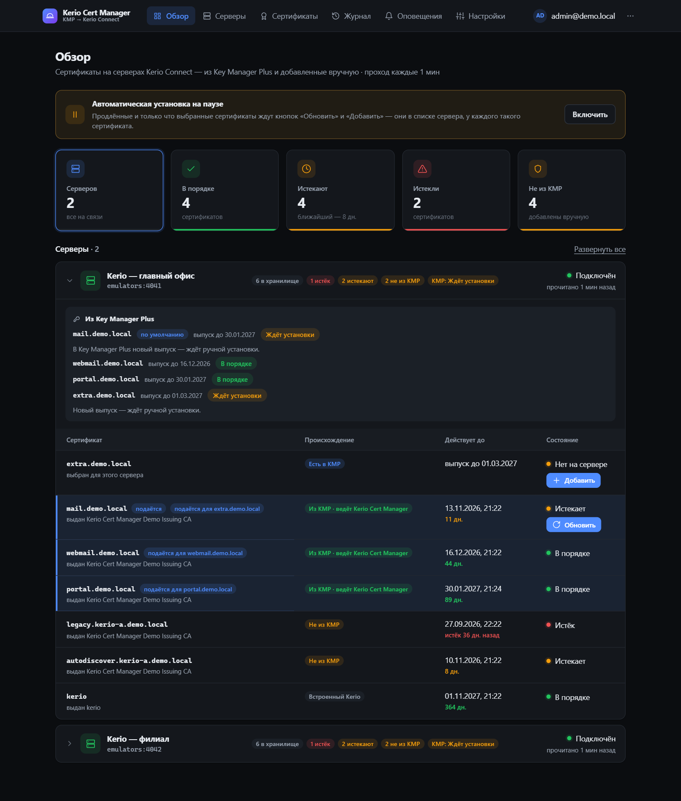

Плитки сверху — и сводка, и единственный фильтр: **Серверов**, **В порядке**, **Истекают**, **Истекли**, **Не из
KMP**. Нажмите плитку — фильтр, нажмите ещё раз — снять.

Карточка сервера показывает число сертификатов в хранилище, проблемы и состояние привязанных сертификатов KMP.
Развёрнутая, она перечисляет:

- **Из Key Manager Plus** — привязанные сертификаты: какой по умолчанию, текущий выпуск в KMP и состояние (*В
  порядке*, *Ждёт установки*, *Не установлен* с причиной).
- **Хранилище** — каждый сертификат в Kerio: *подаётся* (по умолчанию) и *подаётся для имени*, происхождение
  (**Из KMP · ведёт Kerio Cert Manager**, **В KMP**, **Не из KMP**, **Встроенный Kerio**), срок и состояние. Кнопки
  есть только у сертификатов, выбранных для этого сервера. Есть в Key Manager Plus выпуск новее, которого ещё нет в
  Kerio, — под состоянием кнопка **«Обновить»**. Выбранного сертификата нет в хранилище — он первой строкой, *Нет на
  сервере*, с кнопкой **«Добавить»**. Обе ставят именно этот сертификат, со свежим кодом второго фактора; пока
  установка в очереди — *В очереди*. У сертификатов, не выбранных для сервера, — чужих и положенных вручную, — кнопки
  нет: сначала выберите имя в настройках сервера.

## 9. Серверы

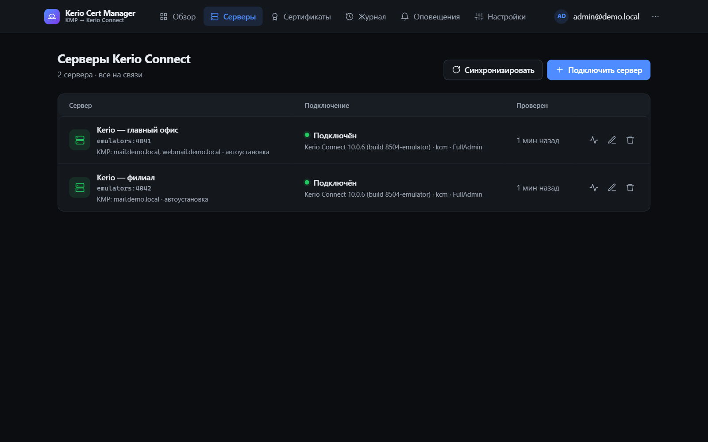

| Элемент | Что значит |
|---|---|
| **Подключён** / **Нет связи** / **Работает…** | Состояние связи; *Работает…* — сервер прямо сейчас в проходе синхронизации |
| ⚡ **Проверить** | Проверить связь и вход сейчас (и после того, как Kerio отверг пароль) |
| ✏ **Изменить** | Сертификаты и подключение (раздел 7.1) |
| 🗑 **Удалить** | Перестать вести сервер. Каждый раз спрашивает свежий код. На Kerio ничего не меняется, история установок остаётся |
| **Синхронизировать** | Проход сейчас: опрос KMP и проверка всех серверов |

## 10. Сертификаты

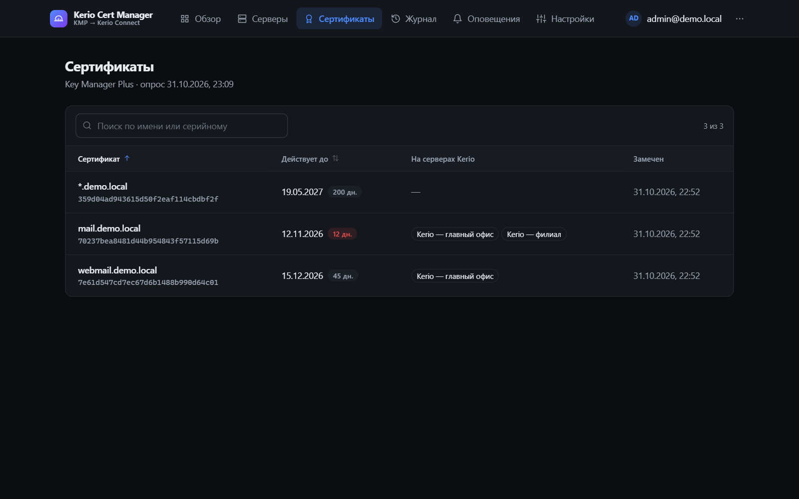

Сертификаты последнего опроса KMP: Common Name, серийный номер, срок, сколько осталось, и на какие серверы они
привязаны (по умолчанию или по имени). Только просмотр — скачать сертификаты и ключи из сервиса нельзя.

## 11. Журнал установок

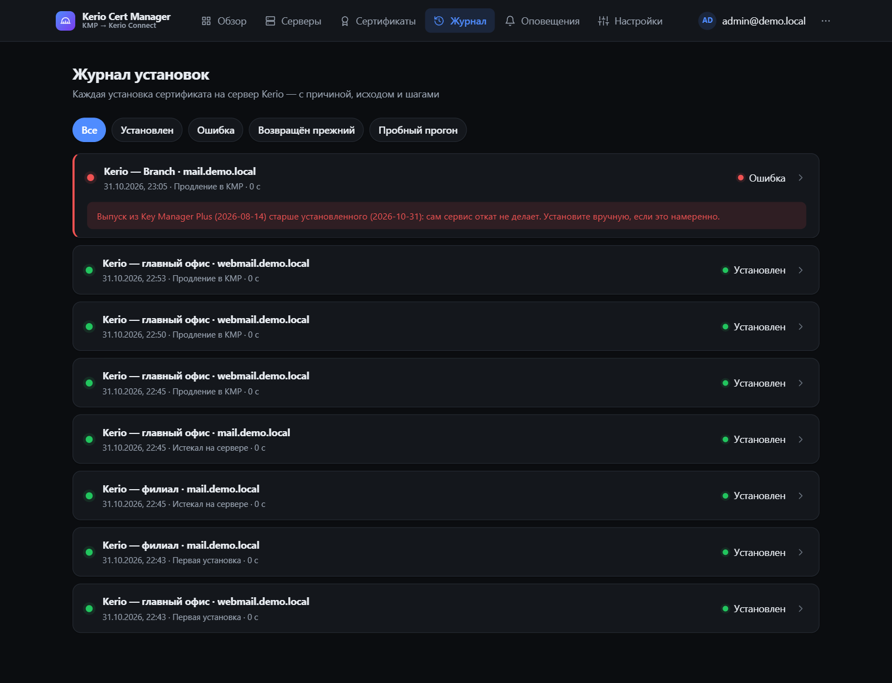

Каждая установка: сервер, сертификат, время, причина (*Первая установка*, *Продление в KMP*, *Истекал на сервере*,
*Вручную*, *Повтор*), исход (**Установлен**, **Ошибка**, **Возвращён прежний**, **Пробный прогон**) и
длительность. Нажмите на установку — шаги со временем, серийный номер, отпечаток SHA-256 и идентификатор в хранилище
Kerio. Фильтры сверху — по исходу.

## 12. Оповещения

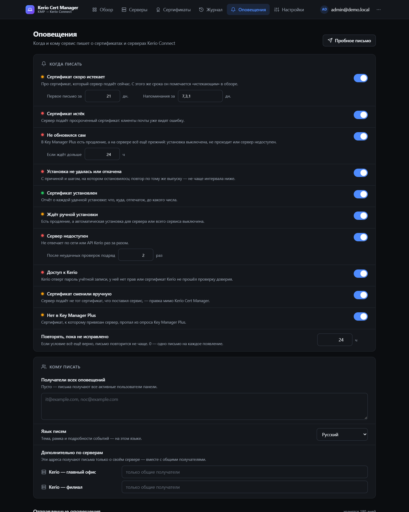

**Когда писать** — у каждого события свой выключатель:

| Событие | Когда |
|---|---|
| Сертификат скоро истекает | Сертификат, который подаёт сервер, истекает в пределах *первого письма* (по умолчанию 21 день), затем напоминания (7, 3, 1) |
| Сертификат истёк | Сервер подаёт истёкший сертификат |
| Не обновился сам | В KMP есть продление, а на сервере через *N* часов всё ещё прежний |
| Установка не удалась или откатилась | С причиной и шагом, где остановилась |
| Сертификат установлен | Отчёт о каждой удачной установке |
| Ждёт ручной установки | Есть продление, но автоустановка выключена |
| Сервер недоступен | После *N* неудачных проверок подряд |
| Доступ к Kerio | Kerio отверг пароль, у учётной записи нет прав или сертификат не прошёл проверку доверия |
| Сертификат сменили вручную | Сервер подаёт не тот сертификат, что поставил сервис |
| Нет в Key Manager Plus | Привязанный сертификат пропал из опроса KMP |

**Повторять, пока верно** — верное предупреждение повторяется не чаще этого (0 — одно письмо на случай).

**Кому писать** — получатели всех оповещений (пусто — все активные пользователи панели), **язык писем** (тема,
рамка и подробности событий) и дополнительные получатели для каждого сервера.

**«Пробное письмо»** проверяет весь путь; **«Отправленные оповещения»** внизу хранят историю 180 дней. Правка
оповещений требует свежего кода.

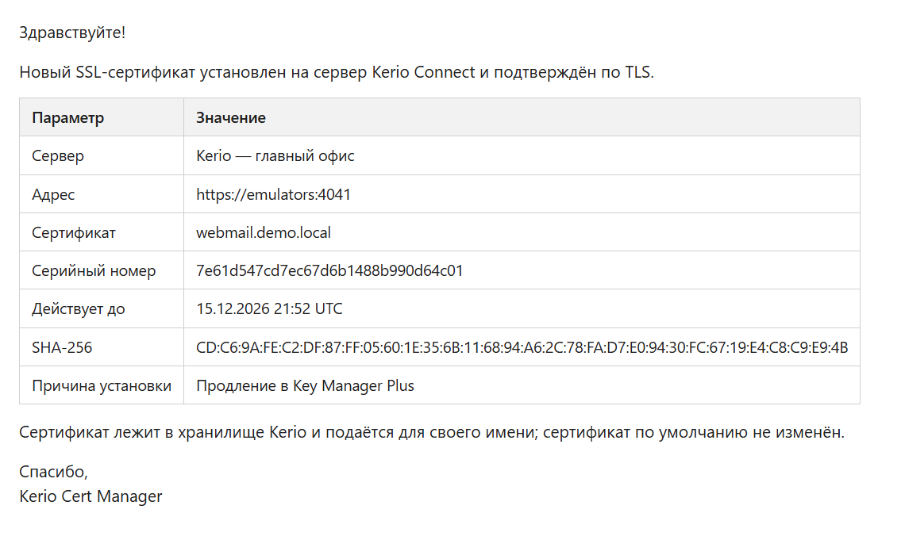

## 13. Пользователи, журнал действий, безопасность и профиль

**Пользователи** — пригласите коллег по почте (или передайте ссылку приглашения сами, если почта не настроена);
каждый задаёт свой пароль и аутентификатор. Для каждого: сменить имя, пригласить ещё раз, ссылка сброса пароля,
разблокировать, сбросить 2FA, завершить сессии, отключить или удалить.

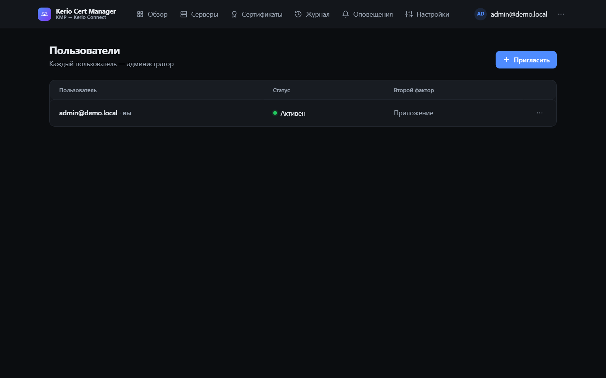

**Журнал действий** — кто входил, что изменил (со старыми и новыми значениями), что поставил, кому отказано.
Журнал только дописывается и связан цепочкой хешей; **«Выгрузить CSV»** скачивает его.

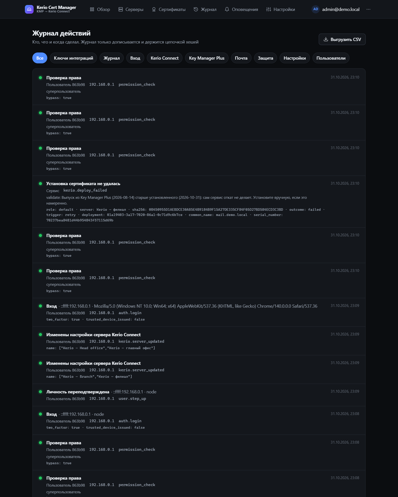

**Безопасность** — сколько действует подтверждённый код для опасных действий, попыток входа до блокировки и время
блокировки, время на ввод кода, выход при бездействии и предельная длина сессии, требования к паролю, срок ссылки
приглашения и предел писем в час на адрес.

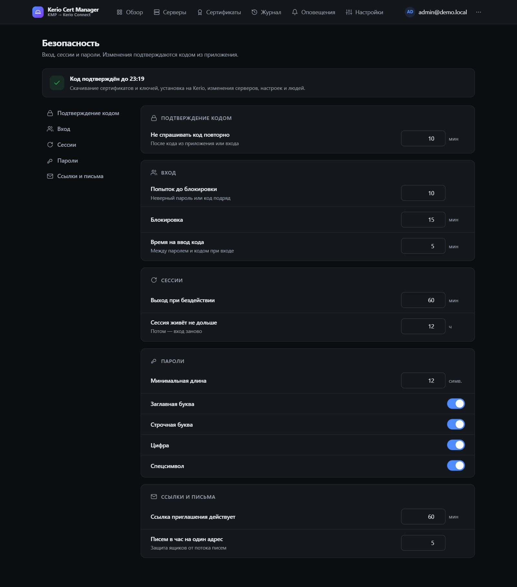

**Профиль** — имя, **язык интерфейса** (русский, английский, украинский — для панели и текстов сервера; следует за
вами на любое устройство), смена пароля, второй фактор и активные сессии (любую, кроме текущей, можно завершить).

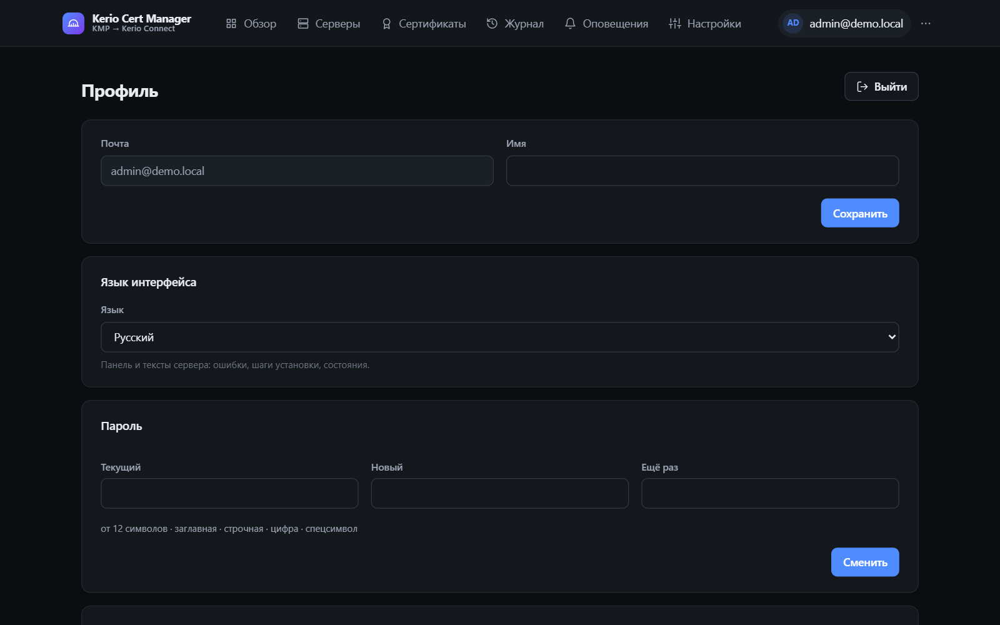

## 14. Повседневная работа

- **Сертификат продлили в KMP.** За один проход сервис это заметит и поставит его на каждый сервер, где он
  используется (или напишет *«Ждёт ручной установки»*, если автоустановка выключена), затем пришлёт отчёт.
- **Обновить / Добавить.** Обзор → развернуть сервер → **«Обновить»** или **«Добавить»** под состоянием
  сертификата, выбранного для этого сервера, со свежим кодом. Так же
  ставится и более
  старый выпуск, если вы так решили (сам сервис этого не делает).
- **Откат.** Не появился новый сертификат на всех проверяемых портах — прежний возвращается и проверяется; в журнале
  — **«Возвращён прежний»**, в письме — почему. Следующая попытка — после паузы.
- **Пробный режим.** **Настройки → Синхронизация → Пробный режим** покажет, что было бы, не трогая Kerio.
- **Обновление сервиса.** `docker compose pull`, `docker compose run --rm migrate`, `docker compose up -d` (или новый
  `KCM_IMAGE` в Portainer). Сначала снимите копию базы.

## 15. Если что-то не так

| Признак | Что делать |
|---|---|
| **Сертификат Kerio не прошёл проверку доверия** | Сертификат на порту администрирования сменили мимо сервиса или закреплён не тот отпечаток. Сверьте отпечаток в администрировании Kerio и задайте его заново на вкладке **«Подключение»** |
| **Kerio отверг пароль** | Сервис перестал входить, чтобы не заблокировать учётную запись. Задайте новый пароль на вкладке **«Подключение»** или нажмите **«Проверить»** |
| **У учётной записи нет прав** | Учётной записи сервиса нужно полное администрирование в Kerio |
| **Key Manager Plus: ошибка** | Проверьте адрес (имя из сертификата, не IP), ключ API и доступность порта 6565. Для внутреннего УЦ дайте контейнеру корень (`SSL_CERT_FILE`) |
| **Каждая установка откатывается** | Один из проверяемых портов не отвечает или подаёт другое. Уберите закрытые порты из списка или откройте их сервису |
| **Не установлен: выпуск KMP старше установленного** | Защита от отката. Если так и задумано — **«Обновить»** |
| **Сертификат имени поставлен, но не подаётся** | В хранилище есть версия того же имени, действующая дольше, и она не своя (купленная или положенная вручную). Уберите её в Kerio, если она больше не нужна |
| **Адрес ведёт на сам сервис или в служебную сеть** | Kerio не может быть на loopback или link-local; укажите настоящий адрес сервера |
| **Потерян доступ** | `./scripts/reset-access.sh admin@example.com` на сервере (Portainer: `KCM_RESET_ACCESS_EMAIL` / `KCM_RESET_ACCESS_PASSWORD`, затем очистить) |
| **После обновления сервис не стартует** | Выполните `docker compose run --rm migrate`: на отставшей схеме сервис не стартует |

Логи контейнера: `docker compose logs api` (JSON по строке, без секретов).

## 16. Вопросы и ответы

**Удаляет ли сервис сертификаты из Kerio?** Только свои старые версии (из KMP или поставленные им) и только после
удачной установки, оставляя одну предыдущую. Купленные и положенные вручную сертификаты не удаляются никогда.

**Где хранятся закрытые ключи?** Нигде. Ключ выгружается из KMP на одну установку, живёт в памяти и затирается
после неё. Пароли и ключ API хранятся зашифрованными AES-256-GCM под мастер-ключом.

**Почему нельзя добавить порт 25 или 587?** На них STARTTLS: обычного рукопожатия TLS там нет, проверить результат
нельзя. Kerio подаёт на них то же хранилище сертификатов.

**Какой сертификат делать по умолчанию?** Тот, что покрывает hostname / имя MX сервера (например
`mail.example.com` или wildcard `*.example.com` плюс `example.com`): клиенты без SNI всегда получают сертификат по
умолчанию.

**Можно ли один сертификат на несколько серверов?** Да — привяжите тот же сертификат KMP к каждому; каждый сервер
ставится и проверяется отдельно.

**Можно ли запустить два экземпляра сервиса?** Проход берёт аренду каждого сервера, так что два процесса не ставят на
один сервер одновременно. Оставьте `KCM_RUN_WORKER=true` у одного экземпляра.
